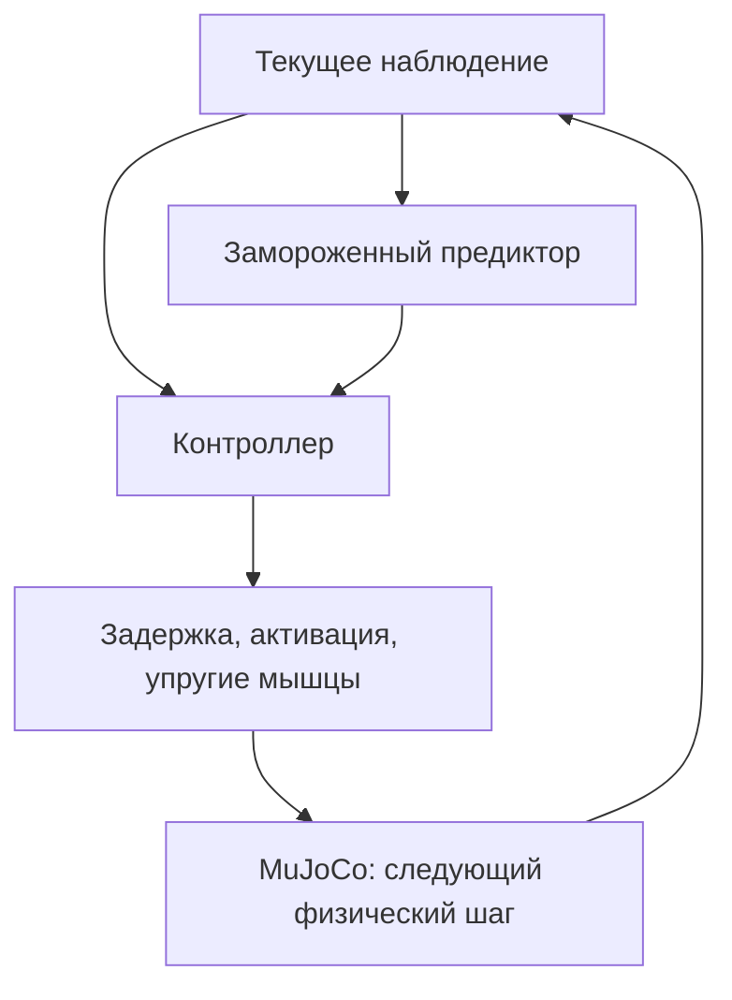

# Архитектура и решения V0

Дата решения и проверки внешних источников: **2026-10-29**.

V0 — воспроизводимый эксперимент с управлением мышечными усилиями: сгибание
локтя с неподвижным плечом, по мотивам preacher curl. Это собственная модель
с одной степенью свободы и четырьмя условными мышечными тягами. Численные
параметры задают эксперимент, а не анатомию конкретного человека.

| Слой | Решение V0 | Дальнейшее развитие |
| --- | --- | --- |
| Механика | MuJoCo CPU, собственный MJCF | Проверенные модели MyoSuite после аудита |
| Мышцы | Собственная модель последовательной упругости | Калибровка и сравнение моделей |
| Управление | Аналитическая опорная траектория, базовый контроллер, опциональный PPO | MuscleMimic-подобное обучение движениям |
| Прогноз | Обучаемый прогноз ошибки через 100 мс | Проверка устойчивости при смене policy |
| Отображение | Телеметрия модели | Отдельный UE5-проект, адаптер, Flesh/ML Deformer |

## ADR-001. Единственный источник физического состояния

**Принято:** MuJoCo на CPU определяет положение, скорость, время симуляции и
результат приложенных мышечных усилий. Собственная модель мышц вычисляет силы
и передаёт их механической модели; она не перезаписывает позу ради слежения.
В V0 момент локтя передаётся через `qfrc_applied = sum(moment_arm * force)`.
Трёхмерные силы в местах анатомических прикреплений здесь не приложены.

Среда имеет интерфейс Gymnasium. Шаг управления может включать несколько
фиксированных физических подшагов. Задержка, активация, состояние упругих
элементов и утомление обновляются на согласованной временной сетке.
Значения частот и все параметры сохраняются вместе с результатом запуска.
Окружение текущей проверки: Python 3.12.14, MuJoCo 3.17.0, Gymnasium 1.4.0,
NumPy 2.5.4. Это не подтверждение совместимости с MuJoCo внутри URLab.

Будущий UE-процесс получает согласованный снимок завершённого шага. Внешние
силы от взаимодействий, если они появятся, возвращаются в MuJoCo с явными
временем и системой координат. Обратная связь от Flesh пока не предусмотрена.
Так поза и контакты персонажа не рассчитываются одновременно двумя движками.

## ADR-002. Податливость должна участвовать в механике

**Принято:** каждая из четырёх тяг содержит активный элемент с зависимостью силы
от длины и упругий элемент последовательно с ним. Длина мышечно-сухожильной
единицы делится между ними. Сила упругого элемента зависит от его растяжения;
его состояние влияет на силу следующего шага и запасённую упругую энергию.

Внутреннее состояние обновляется неявным решением демпфированного баланса
сил. Это численная стабилизация упрощённой модели. Демпфирование, пределы
длины и допуски решателя должны оставаться видимыми параметрами эксперимента.
Неудача решения, насыщение или ограничение силы должны попадать в диагностику.

Последовательная упругость здесь механически действует, но ещё не означает
валидированную модель сухожилия человека. Нет индивидуальной калибровки,
подробной геометрии волокон, достоверной модели повреждения или сустава.

Причина собственного компонента: штатная модель `<muscle>` в MuJoCo
предполагает нерастяжимое сухожилие. Параметр `stiffness` обычного spatial
tendon создаёт пассивную силу вдоль всей заданной траектории; одно его
добавление не вводит независимое разделение длины на волокно и сухожилие.
Источники: [MuJoCo, Muscles](https://mujoco.readthedocs.io/en/stable/modeling.html#muscles),
[MJCF tendon](https://mujoco.readthedocs.io/en/stable/XMLreference.html#tendon).

## ADR-003. Отдельные состояния управления и мышц

Путь сигнала: `u` → очередь моторной задержки → `u_delayed` → активация `a`
→ усилие мышцы → движение. Задержка передачи команды и постоянная времени
активации — разные параметры. Их нельзя молча складывать в один фильтр.

Сброс среды сбрасывает очередь, активацию, упругие состояния и capacity.
Логирование сохраняет параметры задержки и начальное заполнение очереди.
Для воспроизведения rollout недостаточно одних `qpos` и `qvel`.

Собственная очередь V0 делает этот дополнительный state явным и переносимым.
Это не утверждение об отсутствии встроенных задержек в MuJoCo: текущая
документация описывает `nsample`, `delay` и историю для actuators/sensors.
Переход на них требует проверки версии и идентичности временной семантики.
Источник: [MuJoCo, Delays](https://mujoco.readthedocs.io/en/stable/modeling.html#delays).

`capacity` — ограниченная переменная доступной силы. Её снижение при нагрузке
и восстановление в покое задают простую модель утомления. Параметры этой
модели не превращают её в предсказатель физиологической усталости человека.

## ADR-004. Предиктор работает во время управления

**Принято:** предиктор получает базовое **текущее** наблюдение среды.
Кандидатная новая команда `u` не входит в его вход. Выход добавляется к
наблюдению контроллера как дополнительный признак, включая runtime inference.

Два выхода — будущие знаковые ошибки угла и угловой скорости:

\[
\hat{\mathbf e}_{t+H}=f_\theta(o_t^{base}),\qquad
\mathbf e_{t+H}=\begin{bmatrix}
q(t+H)-q_{ref}(t+H)\\
\dot q(t+H)-\dot q_{ref}(t+H)
\end{bmatrix},\qquad H=0.1\;\mathrm{s}.
\]

Единицы выходов — радианы и радианы в секунду. V0 использует MLP на NumPy;
обёртка среды добавляет эти два признака к базовому observation.

Горизонт должен покрывать выбранную моторную задержку: `H >= motor_delay`.
Если задержка увеличена за этот предел, конфигурацию нужно отклонить или
переопределить горизонт и заново обучить predictor. Формат и нормализация
признаков и target сохраняются в артефакте модели.

Предиктор обучается на фактическом продолжении rollout. Последние samples,
для которых ещё нет полного горизонта, исключаются; метка не пересекает
сброс или границу эпизода. Train/validation делятся по эпизодам, чтобы
почти одинаковые соседние временные окна не попадали в обе части.

Это **прогноз при policy, собравшей данные**. Он не сравнивает альтернативные
действия и не является action-conditioned world model. После смены policy
распределение будущих ошибок меняется, даже при неизменной механике.

Рабочий цикл:

1. Собрать rollout с указанной версией policy и конфигурации среды.
2. Обучить предиктор; проверить ошибку на отдельных эпизодах и простом baseline.
3. Зафиксировать его веса и нормализацию на следующий этап обучения policy.
4. Запускать его на текущих наблюдениях и добавлять результат к входу policy.
5. Периодически собирать свежие данные, переобучать и версионировать predictor.

Текущий observation V0 включает полную очередь ожидающих команд, состояния
мышц и генератора reference. Поэтому задержка не скрыта от контроллера в
этой симуляционной постановке. Наблюдение только через ограниченные сенсоры,
история и рекуррентная сеть — отдельные будущие варианты. Predictor не имеет
доступа к будущему состоянию симулятора во время inference.

## ADR-005. Reward и нагрузка имеют проверяемые значения

Главная задача — следовать заданной траектории локтя. Регуляризаторы могут
штрафовать усилие, резкие изменения команды, крайний ROM, растяжение и
снижение capacity. Каждый компонент сохраняется отдельно от общей награды.

`pain_proxy`, `joint_load_proxy`, stretch и fatigue — **инженерные proxy**.
Они не измеряют боль, повреждение, риск травмы или нагрузку суставного хряща.
В этой модели нет тканей и сенсорных механизмов, необходимых для таких
утверждений. Название `joint_load_proxy` нельзя подписывать в UI как
«контактная сила в локте». Порог — параметр эксперимента, не клиническая норма.
В V0 `summed_tendon_force_proxy_N = sum(tendon_force_N)`: при неотрицательных
силах это также сумма модулей натяжений. Такая сумма отражает
совокупное натяжение, в том числе коактивацию антагонистов. По приложенным
обобщённым моментам нельзя восстановить анатомическую суставную контактную
силу; суффикс `_N` обозначает единицы proxy, а не клинический смысл.

Низкая итоговая penalty не гарантирует хорошего движения. Вместе с reward
оцениваются ошибка слежения, максимумы сил и strain, время у границ ROM,
насыщение команд, capacity и численная устойчивость.

## ADR-006. Телеметрия передаёт состояние, а не впечатление

Следующая таблица фиксирует смысл каналов; точные ключи и размерности
определяет версионированный контракт, согласованный с экспортёром.

| Канал | Единицы / смысл |
| --- | --- |
| `sequence`, `episode`, `simulation_time_s` | Номер снимка и время эпизода после control step |
| `joints[]` | Угол/скорость локтя и команда; полноценный bone pose — будущее расширение |
| `u` | Новая нормированная команда возбуждения |
| `u_delayed` | Команда после моторной задержки |
| `a` | Состояние активации мышцы, диапазон `[0, 1]` |
| `force_N` | Положительное натяжение в ньютонах; знак адаптера задаётся явно |
| `tendon_strain` | Относительное растяжение относительно slack length |
| `capacity` | Остаточная доступная доля силы, диапазон `[0, 1]` |
| load / pain / ROM proxies | Раздельные величины с формулами и масштабами |
| prediction | Знаковые ошибки угла/скорости, горизонт и версия predictor |

Порядок мышц и единицы входят в контракт. Получатель использует последний
полный снимок и может интерполировать визуальную позу между снимками.
Потеря кадра отображения не должна задерживать физический шаг; потеря
физической записи в исследовательском логе должна обнаруживаться по номеру.

**Активация ≠ сила ≠ утомление.** При одинаковой активации сила меняется с
длиной, скоростью, упругим состоянием и capacity. Пассивная растяжка может
создавать натяжение при слабой активации. Для отображения нужны разные шкалы.

## ADR-007. UE5 — следующий интеграционный этап

В V0 нет UE-проекта, работающего URLab-адаптера, Flesh-ассета или обученной
ML Deformer. Экспорт телеметрии сам по себе не доказывает их интеграцию.

Кандидат — [URLab](https://github.com/URLab-Sim/UnrealRoboticsLab), сторонний
плагин в стадии [alpha](https://github.com/URLab-Sim/UnrealRoboticsLab/blob/main/docs/changelog.md),
с UE 5.7 как проверенной авторами версией. Его наличие
сокращает работу с импортом MJCF, но не переносит собственную Python-модель
мышц, predictor и дополнительные состояния автоматически.
Опубликованный MJCF coverage URLab проверялся на MuJoCo 3.10.0-dev;
совместимость с MuJoCo 3.17.0 из V0 — отдельный ещё не пройденный этап.

Первый адаптер должен оставлять механику во внешнем MuJoCo-процессе,
передавать позу и отдельные мышечные каналы, проверять metre→centimetre,
handedness, имена и временные метки. У URLab puppet-вход и стандартный
state-readout имеют разный состав: наличие `act` в ответе не доказывает
возможность записать внешний activation через puppet. См.
[protocol](https://github.com/URLab-Sim/UnrealRoboticsLab/blob/main/docs/reference/protocol.md).

Flesh предполагается использовать для визуальной деформации, привязанной к
скелету. ML Deformer — для обученной аппроксимации деформации, с костями и
явными curves активации/силы. Нужны собственные соответствия мышц,
деформационные примеры и проверка изометрического напряжения: одна поза
может иметь несколько уровней активации и натяжения.

Источники: [Flesh overview, UE 5.7](https://dev.epicgames.com/documentation/en-us/unreal-engine/chaos-flesh-overview?application_version=5.7),
[ML Deformer inputs](https://dev.epicgames.com/documentation/unreal-engine/ml-deformer-framework-in-unreal-engine?lang=en-US).
Параметры и API более новой документации проверяются заново на выбранной UE.

Дальнейшая последовательность: сгибание локтя → приседание → ходьба → бег с
поворотом → бег с несколькими целями и защитными движениями. Каждый переход
требует отдельной модели, задачи, данных и проверки; успех V0 не является
свидетельством готовности полнотелого контроллера.
