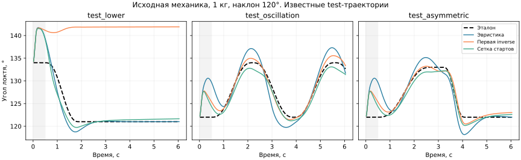

# Иерархия управления рукой: траектория → ускорение → мышцы

Начато 2026-11-11. Новая постановка после
[позиционного PPO](arm-stagnation-exploration.md) и
[неудачной экономизации](arm-effort-curriculum.md).
Реализация — `src/myo/arm_hierarchy.py`, запуск —
`scripts/train_arm_hierarchy.py`. Это отдельный контракт; прежнее позиционное
демо и его checkpoint не заменяются.

**Текущий результат:** [оба уровня нейронные](arm-neural-upper.md),на исходной
механике11/11 train,5/5 расширенного validation и3/3 известных test движений;
mean test RMSE1,043°. Lower обучен inverse supervision,upper —imitation
эвристики;PPO не улучшил выбранные варианты. Это не успешное самостоятельное
RL-освоение движения.
Область подтверждения:120–135°,1 kg,наклон плеча120°,capacity1 при старте,
короткие6-s эпизоды. Это не универсальный контроллер руки/нагрузок.

```bash
.venv/bin/python3 scripts/demo_arm_hierarchy.py --motion oscillation --view
```

Default checkpoint: `runs/arm_hierarchy/neural_upper/best.zip` и metadata.
Веса локальные ignored. `--motion test_lower` показывает исправленное
опускание сверху;`--motion fast_up_soft_down` —асимметричное движение.
Без `--view` выполняется один headless-эпизод. В окне Space —пауза,R —новый
запуск,F —камера,Esc —закрыть. В конце состояние сохраняется до R,без
автоматических перезапусков. Это воспроизведение заданной траектории;
интерактивное позиционное demo остаётся отдельным прежним скриптом.

## Три этапа

1. Эталон задаёт покадровые `q_ref`, `v_ref`, `a_ref`. Эвристический верхний
   уровень по отклонению от эталона выдаёт будущую команду ускорения.
   Проверяем всю цепочку с диагностическим распределителем мышечных усилий.
2. PPO обучает нижнюю сеть выполнять такие команды через шесть возбуждений.
   Целевого положения, скорости эталона, времени/фазы и имени движения во
   входе нижней сети нет. Проверяем и ускорение, и результат всей иерархии.
3. Нижний уровень заморожен;обучена верхняя сеть команд ускорения по эталону
   и ощущениям. После imitation выполнен PPO с наградой за соответствие
   `q_ref` и `v_ref`,а не за нулевую абсолютную скорость. Best остался imitation.
   [Схема,гиперпараметры и результаты](arm-neural-upper.md).

## Тайминг и эвристика

Физика остаётся исходной: MuJoCo, 1 DOF, шесть мышц, шаг физики 1 ms,
управления 20 ms, транспортная задержка 40 ms, динамика активации и
независимые series-elastic сухожилия. Рука и груз имеют прежние массы.
Нет мгновенного момента, teacher-preload или исправления положения/скорости.
Trigger всегда 1; восстановленная capacity в начале равна 1.

Команда, выданная в `t`, задаёт среднее ускорение интервала `[t+40,t+60) ms`.
Её измерение — `(v(t+60)-v(t+40))/0.02`; оно появляется в конце этого
интервала. Нижняя сеть видит очередь уже выданных заданий с дедлайнами
0/20/40 ms, отдельно от очереди задержанных возбуждений мышц.
Первые два интервала не оцениваются; последние две команды досчитываются
после окончания выдачи. Задержка награды сохраняется в PPO/GAE.

Верхний уровень использует причинную приблизительную экстраполяцию на 50 ms:

```
q_hat = q + 0.05*v + 0.5*0.05²*a_last
v_hat = v + 0.05*a_last
a_ff = (v_ref(t+0.06) - v_ref(t+0.04))/0.02
a_cmd = clip(a_ff + 16*(q_ref(t+0.05)-q_hat)
                  + 8*(v_ref(t+0.05)-v_hat), -20, 20)
```

`a_last` измерено на предыдущем интервале. Это не точный предиктор физики;
будущая реальная поза в расчёте отсутствует. Предстоящий эталон известен
верхнему уровню как задание. Активность не становится мгновенной на 40 ms:
низкая точность ускорения может потребовать другого горизонта/окна.

## Эталонные движения и условия первого опыта

Сначала локальная зона 120–135°, в которой уже получалось позиционное
управление, масса груза 1 kg, наклон плечевой кости 120°. Не начинаем
одновременно с полным кругом ориентаций и всеми массами.

Каждый эпизод — 6 s плюс 40 ms досчёта; первые 0,5 s эталон неподвижен.
Переходы — квинтические сегменты с нулевыми скоростью и ускорением на концах.
Периодическое движение пока составлено из таких полуволн, а не из синуса.
Интерфейс уже возвращает все три производные покадрово.

| Набор | Движения |
| --- | --- |
| Train | Удержания 120/135°, подъём/опускание за 1,6 s, осцилляция с полупериодом 1,6 s, подъём 0,8 s/опускание 2,4 s и наоборот |
| Validation | Подъём 122→133° за 1,3 s; осцилляция 123–132° с полупериодом 1,3 s; подъём 121→134° за 1 s/возврат 2,1 s |
| Test | Опускание 134→121° за 1,4 s; осцилляция 122–134° с полупериодом 1,7 s; подъём 122→133° за 2,2 s/возврат 0,9 s |

Разделение по полным движениям. Test не участвует в выборе checkpoint;
после первого просмотра он становится известным контрольным набором.

## Нижняя сеть и обучение

147 входов: 143 прежних нормированных физических/history/mount каналов без
12 каналов текущей и прошлых позиционных команд, три ускорения/5 rad/s²,
один pressure исследования. История возбуждений и моторная очередь сохранены.
Actor/critic — раздельные эффективные 4×128 SiLU; выход — шесть независимых
Beta-распределений возбуждения. Для проверки используется их среднее.
Параметры инициализируются заново: позиционный checkpoint имеет другую цель
и несовместимый вход. Предиктор не используется; неактивные старые ветви
`ArmPolicy` остаются замороженными техническими элементами реализации.

PPO/RMSprop, LR 1e−5, rollout 4×256, batch128, 10 epochs, γ=0,99,
GAE λ=0,95, clip0,2, entropy0,001, target KL0,03. Награда нижнего уровня:

```
r = -0.1*log1p(((a_actual-a_due)/5)**2) - 0.1*physical_failure
```

Штрафов за усилие, позицию и абсолютную скорость нет. Ненулевой градиент
по ошибке сохраняется и вдали от нужного ускорения. Это функция награды;
PPO не дифференцирует MuJoCo по возбуждению. Начальная ветвь — без
дополнительного расширения Beta. Отдельный `--broaden` включает давление
при отсутствии снижения среднего абсолютного acceleration-error за две
соседние части окна 0,8 s. Он не использует целевой угол и не повышает силу
мышц. Это новая эвристика исследования, не биологическая модель.

Checkpoint выбирается по числу физических срывов, затем по validation RMSE
ускорения. Отдельно считаются RMSE положения и скорости относительно
движущегося эталона после 0,5 s. Предварительный gate: без physical failure,
RMSE угла ≤3°, скорости ≤10°/s, ускорения ≤3 rad/s² во всех train/validation
движениях. Выполнение gate — основание остановить нижний этап и оценить
test; один успешный seed не устанавливает устойчивость метода.
Плато: при наличии минимум шести проверок последние четыре не дают ≥1%
улучшения лучшей validation RMSE ускорения из более ранних проверок.
Исчерпание бюджета отдельно от плато.

## Запуск и отчётность

Только один тяжёлый процесс, CPU12–15, nice19, ionice idle, Torch/BLAS по
одному потоку; обучение headless. Префикс для следующих команд:

```bash
nice -n 19 ionice -c 3 taskset -c 12-15 env \
  OMP_NUM_THREADS=1 OPENBLAS_NUM_THREADS=1 MKL_NUM_THREADS=1 \
  .venv/bin/python3 scripts/train_arm_hierarchy.py \
  --out runs/arm_hierarchy/feasibility --heuristic
```

Для PPO убрать `--heuristic`, поменять каталог, задать `--steps 65536`.
`--resume PATH` сохраняет weights/RMSprop; identity физики/входа/задач должна
совпадать. Сырые traces, кривые и weights остаются в ignored `runs/`.
Короткие тесты проверяют тайминг, отсутствие цели во входе, точное совпадение
физики при одинаковых возбуждениях и строгий checkpoint. Они не доказывают
успешное управление.

## Проверка эвристической цепочки — 2026-11-11

`runs/arm_hierarchy/feasibility/heuristic.json`, все 13 train/validation/test
движений, 1 kg/наклон120°, по 302 физических интервала. Без обучения,
без physical failure. Этот просмотр test относится к эвристике; результаты
PPO test не используются для подбора checkpoint.

| Движение | RMSE угла, ° | RMSE скорости, °/s | RMSE ускорения, rad/s² | Gate |
| --- | ---: | ---: | ---: | --- |
| Hold120 | 1,316 | 3,709 | 0,142 | Да |
| Hold135 | 1,379 | 5,636 | 0,658 | Да |
| Raise | 2,300 | 7,045 | 0,908 | Да |
| Lower | 1,463 | 4,940 | 0,582 | Да |
| Oscillation | 3,378 | 9,985 | 1,581 | Нет |
| Fast up / soft down | 2,526 | 7,517 | 1,089 | Да |
| Soft up / fast down | 2,531 | 6,067 | 0,932 | Да |
| Validation raise | 1,679 | 5,613 | 0,574 | Да |
| Validation oscillation | 2,631 | 7,530 | 1,005 | Да |
| Validation asymmetric | 2,101 | 6,141 | 0,787 | Да |
| Test lower | 1,555 | 5,516 | 0,622 | Да |
| Test oscillation | 2,592 | 7,221 | 0,990 | Да |
| Test asymmetric | 2,074 | 5,612 | 0,690 | Да |

Итого 12/13, mean RMSE угла2,117°, ускорения0,812 rad/s². Это подтверждает
работоспособность цепочки с мышечными приводами, но не идеальную инверсию
динамики: diagnostic allocator не компенсирует точно будущую активацию,
доставку и series elasticity. Полный gate эвристикой не пройден.

## PPO с нуля — 2026-11-11

Ветка `runs/arm_hierarchy/ppo_lr1e5`, 65536 transitions, 64 rollouts,
остановка по бюджету. Проверки каждые16384; основной цикл с validation
занял399,7 s, финальная оценка трёх наборов выполнялась дополнительно.

| Transitions | Validation RMSE угла, ° | RMSE ускорения, rad/s² | Pass |
| ---: | ---: | ---: | ---: |
| 0 | 16,164 | 4,4384 | 0/3 |
| 16384 | 16,136 | 4,4308 | 0/3 |
| 32768 | 16,100 | 4,4210 | 0/3 |
| 49152 | 16,091 | 4,4186 | 0/3 |
| 65536 | 16,088 | 4,4179 | 0/3 |

Снижение ошибки ускорения0,46%. Best=last. Train0/7 (17,373°;4,8574 rad/s²),
validation0/3, test0/3 (18,623°;5,2539 rad/s²), physical failures0.
Задача не освоена. График почти плоский, но заранее установленное правило
плато требует минимум шести проверок; этот запуск завершён именно по бюджету.

Траектории показывают устойчивую неправильную позу143,8°, а не выполнение
разных заданий. На последней секунде validation ускорение≈0, команды−3,02/
−5,66/−6,37 rad/s²; средние возбуждения сгибателей≈0,095/0,080/0,118,
разгибателей≈0,22/0,14/0,21. В первые0,5 s acceleration RMSE19–21 rad/s²;
проблема не ограничивается длинным горизонтом GAE. Контакт и причинную
чувствительность к команде проверяем отдельно; сами эти числа не доказывают
единственную причину неуспеха.

Следующий controlled comparison: тот же fresh initialization/бюджет с
расширением Beta при застое. После него — перенос старого actor без
переменной позиционной цели: её12 каналов сворачиваются в biases первого
слоя при фиксированном127,5°. Физические колонки и последующие слои
переносятся, новые acceleration-колонки нулевые; выход critic и RMSprop
инициализируются заново. Это предварительный навык удержания одной позы,
а не уже обученный acceleration-контроллер. Тест проверяет сохранение
функции старого actor при этой фиксированной цели. Загрузка parent не
должна расходовать RNG будущего PPO; состояния RNG сохраняются/возвращаются.

## Расширение исследования при застое

`runs/arm_hierarchy/ppo_stall_lr1e5`, 65536 transitions, 406,8 s до последней
validation плюс финальная оценка. Начальные веса, seed, расписание и бюджет
такие же, как у ветви без pressure; меняется только применение pressure.
Численные mean Beta при делении concentrations отличаются на float32-roundoff.

| Transitions | Validation RMSE угла, ° | RMSE ускорения, rad/s² | Pass |
| ---: | ---: | ---: | ---: |
| 0 | 16,164 | 4,4384 | 0/3 |
| 16384 | 16,164 | 4,4385 | 0/3 |
| 32768 | 16,193 | 4,4464 | 0/3 |
| 49152 | 16,287 | 4,4719 | 0/3 |
| 65536 | 16,357 | 4,4914 | 0/3 |

Best=initial. Итог выбранного checkpoint: train0/7;17,449°, validation0/3;
16,164°, test0/3;18,700°, physical failures0. Независимые от шага к шагу
расширенные пробы не помогли в этом опыте. Это не проверка временно связанных
проб и не доказательство бесполезности исследования вообще.

## Перенос навыка удержания

`--initial-actor runs/arm_exploration/stall_audited_continuation/best.zip`,
каталог `runs/arm_hierarchy/fixed_goal_actor_lr1e5`. Без pressure, та же награда,
свежий RMSprop/LR1e−5. Верхняя эвристика и физический reset неизменны.
Начальное validation:0/3,RMSE угла5,099°,ускорения1,6581 rad/s².
Это заметно лучше случайного начала,но само по себе движение не освоено:
старая сеть удерживает фиксированную позу,а новые acceleration-входы пока
имеют нулевые веса.

После65536 PPO transitions:best=last,train0/7 (6,711°;2,0868 rad/s²),
validation0/3 (4,908°;1,5912 rad/s²),test0/3 (4,942°;1,6118 rad/s²),
physical failures0. Начальное представление полезно,но новый навык не освоен.
Кривая validation ускорения:1,6581→1,8337→1,9638→1,6542→1,5912.
Последний блок улучшается,поэтому это также не установленное плато.
На последнем update EV critic0,067,53 optimizer steps из80;раньше EV около0
или отрицательная,один update остановлен уже после9 шагов. Средний KL в
журнале не равен KL последнего minibatch,вызвавшего остановку.

## Отдельная проверка обучаемости обратной динамики

`scripts/pretrain_arm_inverse.py`: supervised-инициализация нижней сети,
**не новый PPO-опыт и не предиктор**. Teacher выполняет те же движения через
мышцы; сохраняются причинное наблюдение `x_t`,команда `u_t` и измеренное
ускорение интервала `[t+40,t+60) ms`. В обучающем примере заменяем только
новое задание ускорения на реально достигнутое: `policy(x_t,a_achieved)→u_t`.
Ошибка —MSE шести возбуждений;градиент через симулятор не проводится.

Будущая величина здесь —переобозначенная **цель** обратной задачи,а не
подсмотренный физический sensor. При исполнении вместо неё поступает
обычная команда верхнего уровня. В этом интервале ещё не могут действовать
неизвестные будущие моторные команды,выданные вt+20/t+40 ms;это отдельно
проверяется replay с резко отличающимися будущими actions. Упругость и
активация сохраняются. Goal вне объявленного диапазона±20 rad/s² исключается.

Train —7 целых teacher episodes,validation —3 других. Test не используется
для supervised-выбора. Та же actor-архитектура/Beta-mean,новая инициализация,
Adam1e−3,batch256,до3000 updates. Выбирается минимум validation excitation-MSE,
затем проверяется реальная замкнутая иерархия на всех наборах. Низкая MSE сама
по себе не означает устойчивое движение на собственных состояниях policy.
Это проверка иной гипотезы,а не изолированное сравнение оптимизаторов.

Первый запуск `runs/arm_hierarchy/inverse_relabelled`:2098 train examples,
900 validation,3000 updates. Best —update3000,train excitation-MSE1,502e−6,
validation2,190e−6 (RMSE возбуждения≈0,00148). Замкнутая физическая проверка:

| Набор | Pass | Mean RMSE угла, ° | Mean RMSE ускорения, rad/s² |
| --- | ---: | ---: | ---: |
| Train | 6/7 | 1,689 | 0,675 |
| Validation | 3/3 | 0,882 | 0,408 |
| Test | 2/3 | 7,098 | 2,182 |

Physical failures0. Учебный hold135:3,213°,чуть за gate;test lower134→121:
19,503°,явный провал при хорошем воспроизведении остальных движений.
Ни маленькая validation-MSE,ни3/3 validation не гарантируют перенос.
Этот test теперь известен;последующие улучшения на нём не являются новой
независимой оценкой обобщения.

Вмешательство во вход той же policy:замена всей очереди acceleration-команд
нулём повышает validation RMSE угла0,882→12,924°. При одинаковом физическом
входе смена нового задания−10→+10 rad/s² меняет mean возбуждения трёх
разгибателей примерно на−0,0313/−0,0318/−0,0319. Сеть использует ускорение;
небольшое абсолютное изменение возбуждения не равно игнорированию команды.
Проба±10 —вмешательство в пределах объявленного диапазона,но не доказательство
точной инверсии во всех таких состояниях/ускорениях.

Следующая проверка —один раунд добавления состояний самой policy. На семи
**учебных** траекториях driver исполняет0,8·policy для расширения состояний;
каждые100 ms независимый native branch получает текущий полный физический
snapshot и пробует teacher excitation на трёх интервалах. Реально достигнутое
ускорение третьего интервала становится новой целью inverse-примера.
Основной rollout не перематывается и не исправляется;масса/поза/capacity
не меняются. Этот branch совпадает с реальной физикой при replay;будущие
неизвестные actions не влияют на его целевой интервал.

Используются только состояния train,без test labels. Половина minibatch —
старые teacher examples,половина —новые. Инициализация из первого inverse
checkpoint,новый Adam1e−3,до3000 updates;выбор по прежним validation episodes.
Это коррекция покрытия данных,не доказательство,что единственная причина
провала была в распределении состояний.

Этот раунд (`inverse_augmented`) собран,но selection по прежнему teacher-MSE
оставил исходную policy:0-й update2,190e−6,после250/500/750/1000 updates
3,162e−5/1,980e−5/1,479e−5/1,754e−5. Stop после1000 updates без улучшения.
Выбранный checkpoint побитово воспроизводит прежние результаты6/7,3/3,2/3.
Последняя обученная policy в этой версии runner отдельно не сохранялась и
не проверялась;поэтому нельзя заключать,что добавленные состояния бесполезны.

Финальная проверка протокола (`inverse_counterfactual`) меняет **два** фактора:

1. Каждые200 ms состояния driver теперь размечаются тремя native branches
   с0,7/1/1,3·teacher excitation. Это разные достигнутые ускорения при одном
   и том же причинном физическом состоянии;нет необходимости угадывать
   чувствительность по единственному action-примеру.
2. В validation добавлены lower133→122° и hold131°,а выбор каждые500 updates
   делается по native failure/pass,затем RMSE угла/ускорения. Прежний
   validation почти не проверял холодный старт сверху. Возбуждение-MSE
   остаётся диагностикой. Сохраняются и best,и last.

Новые branches и perturbation используются только на train. Это не
изолированный эффект одного гиперпараметра и не новый независимый test.
Бюджет1500 updates,инициализация из первого inverse;новый Adam1e−3.

Этот controlled native comparison не улучшил policy:расширенный validation
initial3/5;6,209°,после500 updates0/5;7,335°,после1000 —0/5;6,734°.
Stop1000 без улучшения,best=initial. Высокие validation-starts действительно
выявляют прежний дефект. Новые branches улучшают fit на своей добавке,но
ухудшают старый validation;нельзя считать этот способ расширения готовым.

Ещё одна конкретная проблема покрытия:до этого все **train cold resets**
были только на120°/135°. Промежуточные позы встречались в движении,но не
с холодной активацией0,03 и новой очередью возбуждений. Поэтому следующий
малый набор добавляет hold-эпизоды с initial123/126/129/132°:теперь шесть
регулярных точек120..135°,а не подгонка к единственному неудачному134°.

`inverse_cold_grid`:новая actor-инициализация,teacher inverse examples из
11 train episodes;без policy-driver/CF branches. Validation —прежние3 плюс
lower133 и hold131,не совпадающие с train-starts. Adam1e−3,до3000 updates,
выбор по native failure/pass/позиции/ускорению каждые500. Меняются покрытие
стартов и способ отбора относительно первого inverse;это не изоляция
одного фактора. Test134 остаётся известной регрессионной проверкой.

## Итог сетки стартов

3298 examples из11 teacher episodes,1500 validation examples из5 других
эпизодов. Stop по бюджету3000 updates;best=update2000 по native validation,
а не last и не минимум MSE возбуждений. Веса записаны до просмотра итогового
test. Без дополнительных CF branches или policy-driver.

| Набор | Pass | Mean RMSE угла, ° | Mean RMSE ускорения, rad/s² |
| --- | ---: | ---: | ---: |
| Train,включая4 новых cold-start holds | 11/11 | 1,075 | 0,492 |
| Прежний validation | 3/3 | 0,990 | 0,374 |
| Расширенный validation,включая high starts | 5/5 | 1,122 | 0,541 |
| Известный test | 3/3 | 1,136 | 0,523 |

Physical failures0. Gate одновременно ограничивает ошибки позиции,
**скорости относительно эталона** и ускорения. Новые high-start validation:
lower133 —1,357°/6,683°/s/0,798 rad/s²,hold131 —1,285°/6,874°/s/0,789 rad/s².
Best MSE возбуждения на расширенном validation7,517e−6;не минимальная среди
всех checkpoints. Улучшенное управление нельзя ранжировать только этой MSE.



График относится к опытам нижнего уровня,с одинаковым эвристическим upper.
Серый участок0–0,5 s —холодный старт,который виден на графике,но исключён
из основного RMSE/gate. График не устанавливает новую независимую test-оценку:
неудача134° уже участвовала в анализе протокола. Верхняя эвристика и масса
во всех линиях одинаковы,меняются нижний controller/набор обучающих данных.

Ключевой практический вывод:задача будущего ускорения обучаема этой сетью
при исходной задержке/упругости. В данном опыте явная краткая inverse-задача
с размеченными действиями дала полезный lower;PPO самостоятельно её не освоил.
Это не доказывает невозможность PPO или единственную причину его неудачи.
Подтверждено,что неполное покрытие холодных стартов и выбор по teacher-fit
давали ложное ощущение готовности контроллера.

## Реализованная верхняя нейросеть

Этот lower заморожен. Верхняя policy выдаёт **ускорение**,нижняя —шесть
возбуждений. Upper имеет151 вход,раздельные actor/critic4×128 SiLU,
Gaussian-выход ускорения. Текущий ответ эвристики замаскирован;её команды
использовались только в warmup. Нижний actor получает147 каналов,целевой
угол остаётся исключительно задачей верхнего уровня.

После imitation до2000 updates и32768 PPO transitions best=imitation1500.
Вся нейронная иерархия:11/11 train,5/5 validation,3/3 известных test,
mean RMSE угла1,030°/1,021°/1,043°,failures0. В исполнении готовый ответ
эвристики не используется. [Полный отчёт](arm-neural-upper.md).

Расширение на другие массы/ориентации,полный ROM,длинные удержания и экономия
усилий остаются будущими проверками. Teacher распределяет нагрузку по группам;
нынешняя supervised-фаза не доказывает оптимальность мышечных синергий.
