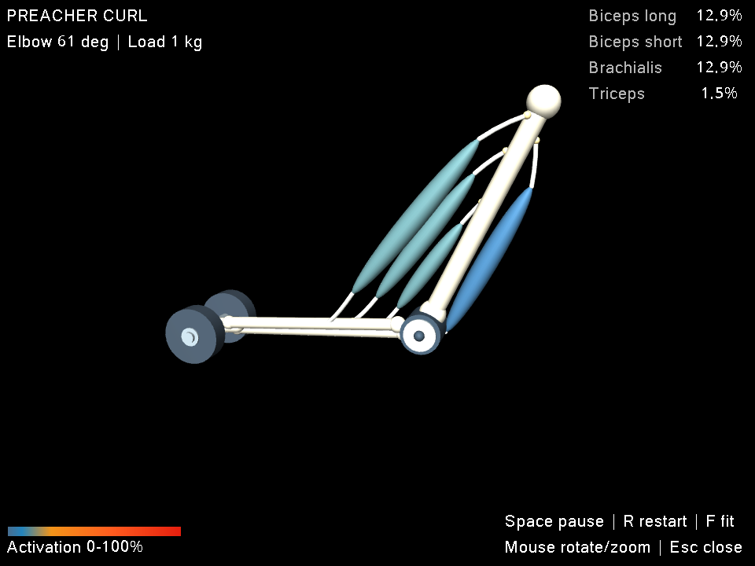

# Демо руки: кости, мышцы и активация

Простой вид для первого эксперимента: плечо закреплено, предплечье сгибается
с грузом, а цвет четырёх мышц показывает их текущее состояние.



Кадр диагностического контроллера после 2 s симуляции; изображение получено
через EGL тем же построителем сцены и подписей.

## 1. Запуск

Из корня репозитория, после [установки](installation.md):

```bash
source .venv/bin/activate
python3 -m myo demo
```

Нужен графический дисплей. Окно работает до закрытия, эпизоды перезапускаются
автоматически. Темп ограничен реальным временем; физический шаг не меняется.
По умолчанию используется диагностический контроллер `heuristic`.

Варианты запуска:

```bash
# Ограничить просмотр 20 секундами симуляции.
python3 -m myo demo --seconds 20

# Использовать свою конфигурацию.
python3 -m myo demo --config configs/preacher_curl.json

# Загрузить ранее обученную policy вместе с её metadata.
python3 -m myo demo --controller runs/ppo_curl.zip

# Явно указать predictor, если он требуется этой policy.
python3 -m myo demo --controller runs/ppo_with_predictor.zip \
  --predictor runs/predictor.json
```

Файлы policy и predictor должны существовать и соответствовать сохранённым
контрактам. Их обучение описано в [README](../README.md).
`python3 -m myo rollout --seconds 20 --viewer` открывает тот же вид;
добавлять `--realtime` не требуется. Для headless-прогона используется `rollout`
без `--viewer`.

## 2. Сцена и значение цвета

Видны светлые плечевая, лучевая и локтевая кости, шарнир локтя, груз,
четыре веретенообразные мышцы, светлые сухожильные пути и точки крепления.
Рядом остаются только угол локтя, масса груза, значения активации четырёх мышц
в процентах, цветовая шкала и краткое управление.

Цвет берётся из **`muscle.activation`** после задержки и динамики активации.
Он не обозначает новую команду возбуждения, силу в ньютонах или утомление.
Шкала фиксирована для всех мышц и кадров; промежуточные цвета интерполируются.

| Активация | Цвет |
| --- | --- |
| 0% | Приглушённый серо-синий |
| 8% | Сине-голубой |
| 25% | Янтарный |
| 60% | Оранжевый |
| 100% | Красный |

Одинаковый цвет не гарантирует одинаковую силу: натяжение зависит также от
длины, скорости, упругого состояния и оставшейся capacity. Эти отдельные
каналы доступны в [телеметрии](telemetry.md).

### Почему у сгибателей одинаковая активация

В стандартном `heuristic` это результат явного правила распределения команды.
Контроллер оценивает нужный момент в локте и при сгибательном моменте добавляет
**одинаковое возбуждение** `biceps_long`, `biceps_short` и `brachialis`.
Начальное состояние активации, моторная задержка и параметры фильтра активации
у них одинаковы, поэтому совпадают и показанные проценты. Максимальные силы,
длины волокон и плечи моментов различаются: равные проценты не означают равный
вклад в движение.

Кроме того, `baseline_action()` задаёт всем четырём мышцам фоновое возбуждение
**0.015**, то есть 1.5%. Поэтому при обычном сгибании трицепс после переходного
процесса остаётся около 1.5%; если контроллер запрашивает дополнительный
разгибательный момент, его команда может быть выше. При reset начальная
активация по умолчанию составляет 3%, поэтому первые кадры могут отличаться.
Этот фон — выбранный параметр диагностического контроллера, а не измеренный
мышечный тонус и не результат обучения стабилизации локтя.

PPO выдаёт четыре независимые команды и не использует это правило распределения.
Однако одно лишь слежение за углом не определяет единственное соотношение сил
мышц. Естественность распределения и полезность коактивации требуют отдельной
проверки модели, задач и критериев обучения.

### Какая мышца — brachialis

`Brachialis` — **плечевая мышца**. Короткий сгибатель у локтя на нашей схеме
соответствует именно ей. Анатомически она начинается на передней поверхности
нижней половины плечевой кости и прикрепляется к венечному отростку и бугристости
**локтевой кости**. Основное костное прикрепление бицепса находится на
**лучевой кости**. См. атлас University of Washington:
[brachialis](https://rad.uw.edu/muscle-atlas/brachialis),
[biceps brachii](https://rad.uw.edu/muscle-atlas/biceps-brachii).

Визуальная точка крепления brachialis вычисляется на поверхности нарисованной
локтевой кости и вращается вместе с предплечьем. Это устраняет зазор между
сухожилием и костью; положение не задаётся отдельной несвязанной координатой.
Относительные размеры четырёх веретён условны: по ним нельзя сравнивать реальные
длины мышц, их волокон или сухожилий. В частности, две головки бицепса здесь
разведены для чтения сигналов, а лопатка и их реальные проксимальные начала
не представлены.

## 3. Управление

| Действие | Управление |
| --- | --- |
| Пауза / продолжение | **Space** |
| Перезапустить эпизод | **R** |
| Вернуть камеру к руке | **F** |
| Закрыть окно | **Esc** или кнопка закрытия |
| Вращать и приближать вид | Мышь, стандартное управление MuJoCo |

Боковые панели MuJoCo скрыты при открытии. **Tab** и **Shift+Tab** могут
показать их снова; для обычного просмотра они не нужны.

## 4. Границы изображения

Кости, пути и крепления — схема для чтения четырёх сигналов. Механика V0
использует постоянные плечи моментов; нарисованные кривые не определяют силу,
strain или момент. Изменение activation меняет цвет, а не рассчитывает
активное объёмное сокращение. Flesh и ML Deformer сюда ещё не подключены.

Окно использует отдельную копию MuJoCo model/data. Визуальное оформление
не меняет механическую модель или её fingerprint, поэтому ранее совместимые
checkpoints сохраняют совместимость при тех же конфигурации и predictor.
Новый вид доступен через CLI `demo` и `rollout --viewer`; прямой API-вызов
`PreacherCurlEnv(render_mode="human")` пока открывает прежний отладочный viewer.

Фактически выполненные проверки перечисляются в [validation.md](validation.md).
