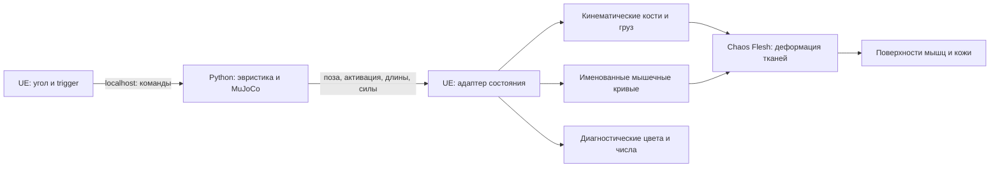

# Десктоп: скамья Скотта, анатомические поверхности и Chaos Flesh

План от **2026-11-07**. Это программа новой работы на Windows-десктопе
с RTX 3060; UE-проект, анатомические поверхности и Flesh-симуляция пока
**не реализованы и не проверены**. Здесь фиксируются решения и критерии этапов.
Общий объём D1: [first-stage.md](first-stage.md); прежняя схема интеграции:
[Unreal README](../integrations/unreal/README.md).

## 1. Два направления и общий результат

| Направление | Где работаем | Ближайшая цель | Источник мышечных команд |
| --- | --- | --- | --- |
| Изображение | Windows-десктоп, Unreal | Рука на скамье Скотта, сокращение и растяжение мышц/сухожилий, затем деформация кожи | Существующая эвристика Python/MuJoCo |
| Обучение | Linux-ноутбук, без UE | Управление той же MyoArm с учётом опыта вертикального стенда | PPO; отдельное предобучение представления как проверяемая гипотеза |

Первый визуальный результат — читаемая рука на скамье: при подъёме видны работа
сгибателей и изменение брюшка, при опускании — растяжение и торможение;
при удержании есть сила без обязательного укорочения. На экране отдельно
показываются активация мышцы и нагрузка сухожилия. Рабочие режимы: кости,
мышцы/сухожилия, кожа. До кожи допускается промежуточный результат с открытыми
мышцами; он не закрывает весь D1.

Успех обучения не блокирует графику. Эвристика не объявляется биологически
оптимальной; её задача здесь — воспроизводимые входы для изображения.
Оба направления используют одни IDs, геометрию, физику, единицы и контракт
состояния. Замена эвристики обученной policy позже не должна менять UE-материалы,
Flesh assets или риг.

## 2. Кто владеет физикой

MuJoCo на десктопе работает **локальным отдельным процессом** вместе с эвристикой.
Ноутбук не является обязательным сервером демо. WSL, удалённый рабочий стол
и потоковое видео не нужны.



MuJoCo рассчитывает движение локтя, вес груза, мышцы, независимые упругие
сухожилия, моторную задержку, активацию, утомление и контакт инженерных оболочек.
Chaos Flesh рассчитывает визуальную объёмную деформацию при заданных костях
и мышечных входах. Его внутренние реакции **не возвращаются в MuJoCo**.
У костей/груза в UE выключено динамическое rigid-body управление: второй
симуляции того же локтя в Chaos не создаём.

Скамья первоначально — неподвижная визуальная опора под уже закреплённое плечо.
Её положение подгоняем к mount MyoArm, а не двигаем физическую руку ради картинки.
Позднее допускается односторонний визуальный контакт тканей со скамьёй;
мягкая опора с обратным влиянием на движение — отдельная будущая задача.

Видимые ткани будут отличаться от фиксированных контактных оболочек MuJoCo.
Если визуальная мышца упирается раньше или позже физического контакта, это
регистрируем как несогласованность. Не скрываем её незаметной правкой угла,
массы груза или дополнительным моментом на суставе.

## 3. Исходная модель и необходимые заготовки

В основе — правая MyoArm из закреплённой версии MyoSim:
`93b0ca8f4ec90c9899ee7f05fee561e9911da91b`. Импортёр
`scripts/prepare_myoarm.py` уже создаёт `data/myoarm/model.xml`,
`muscles.json` и manifest; его подробности — в [myoarm.md](myoarm.md).
Это не FBX-экспортёр, не UE-скелет и не подготовщик мышечных поверхностей.

| Заготовка | Источник/способ подготовки | Что требуется дополнительно |
| --- | --- | --- |
| Кости, суставы, прикрепления и огибания | Тот же MyoArm, его STL/XML и подготовленная MuJoCo-модель | Экспорт mesh-to-body transforms, bind pose и путей в DCC/UE |
| Шесть активных мышечных областей | Официальный BodyParts3D, подгонка к MyoArm | Выбор anatomical IDs, выравнивание, выделение головок и пригодные поверхности |
| Сухожильные объёмы | Собственная упрощённая геометрия по MyoArm и окончаниям брюшек | Отдельные начало/конец, непрерывность с мышцей и костью |
| Кожа/подкожная оболочка | Собственные согласованные поверхности руки | Замкнутый упрощённый подкожный объём и отдельная наружная render surface |
| Скамья и груз | Собственная простая геометрия | Размеры относительно модели, правильная привязка груза к кисти |

Мышечные IDs неизменны: `BIClong`, `BICshort`, `BRA`, `TRIlong`, `TRIlat`,
`TRImed`. BodyParts3D не обязан содержать шесть готовых объектов с точно таким
делением. Если головки объединены, сначала сохраняем исходный anatomical ID,
затем документируем собственное разбиение или явно временную общую поверхность.
Не переименовываем один анатомический объект в шесть независимых мышц.

Мягкие ткани берём с [официальной страницы загрузки BodyParts3D](https://dbarchive.biosciencedbc.jp/en/bodyparts3d/download.html).
У официального архива указана CC BY 4.0; фиксируем конкретный скачанный пакет,
дату, SHA-256, атрибуцию и изменения. Условия проверены по
[странице лицензии](https://dbarchive.biosciencedbc.jp/en/bodyparts3d/lic.html).
Происхождение MyoArm и ограничения исходных компонентов сохраняются отдельно;
см. [источники и workflow](model-sources-and-workflow.md). Исходные и производные
анатомические assets остаются локальными в `data/`; лицензию проекту не назначаем.
Материалы Emil из tutorial служат проверкой инструментария, не заменой нашей руки.

## 4. D0 — подготовить и зафиксировать среду десктопа

Создать отдельный checkout; до начала записать commit кода, Windows/GPU/драйвер,
доступную VRAM, точную версию UE с patch и список плагинов. Опорный workflow
плана — официальный tutorial **UE 5.6**. Если выбрана другая версия движка,
сначала воспроизвести маленький образец и записать соответствие узлов/API;
документацию, которая по умолчанию открывает 5.8, не принимать за инструкцию 5.6.
Автоматическое обновление проекта посреди настройки исключить.

Для C++-адаптера нужны совместимые с выбранным UE Visual Studio C++ toolchain
и Windows SDK. Создать небольшой C++-проект без стороннего персонажа,
включить Chaos Flesh и требуемые им Dataflow/деформеры. Сначала воспроизвести
базовый [Chaos Flesh Quickstart 5.6](https://dev.epicgames.com/documentation/en-us/unreal-engine/chaos-flesh-quickstart?application_version=5.6).
ML Deformer не является условием первого live Flesh; его плагины включать
при проверке соответствующего sample или переходе к оптимизации.

Поднять отдельную Python 3.12-среду **на Windows**. Linux `scripts/setup.sh`
там не считать готовым bootstrap. В новом checkout без `.venv` предполагаемый
PowerShell-вариант:

```powershell
uv venv --managed-python --python 3.12 --seed .venv
.\.venv\Scripts\python.exe -m pip install -e ".[dev]"
.\.venv\Scripts\python.exe scripts/prepare_myoarm.py
.\.venv\Scripts\python.exe -m pytest -q tests/test_myoarm_geometry.py
```

Здесь указан настоящий Windows-путь к интерпретатору 3.12; команды на Windows
**ещё не проверены**. GUI MuJoCo и JAX/MuscleMimic для UE-моста не обязательны.
Нужно проверить создание модели и headless-расчёт; CPU/GPU или межплатформенная
эквивалентность не предполагается без сравнения записанных состояний.

**Выход D0:** запускается минимальный Flesh sample, локально собирается C++-проект,
Python читает тот же manifest. В журнале стоят реальные версии и результаты,
а не только факт установки Launcher.

## 5. D1 — подготовить геометрию и общий риг

В Blender или другом уже доступном DCC собрать рабочую руку из исходных костей.
Нужны плечевой пояс с проксимальными креплениями длинных головок, плечевая кость,
локтевая/лучевая и кисть; плечо/запястье фиксированы, подвижен один локоть.
Не переносить прикрепления длинных головок на плечевую кость ради компактности.

Выгрузить из подготовленной модели и manifest отдельный проверяемый пакет:
иерархию bodies, rest transforms, локальную ось/центр локтя, mesh-to-body offsets,
mount transform, шесть именованных путей и attachment/wrap landmarks.
Такого экспортного скрипта пока нет — его нужно написать. World `body_poses`
из телеметрии не заменяют mesh offsets и не описывают все огибания пути.

Согласовать BodyParts3D с костями по центрам плеча/локтя/запястья, длинам сегментов
и местам креплений. Разрешена подготовка поверхности под механический скелет;
силовые пути и точки MyoArm не перемещаем без отдельной проверки геометрии.
После подгонки: исправить разрывы, самопересечения, нормали и внутренние грани;
выделить симуляционные замкнутые объёмы и независимые render meshes с UV.
Тонкие сухожилия первоначально могут быть отдельными пассивными поверхностями,
привязанными к границам мышцы и кости, без собственного тонкого tet-объёма.
Они не получают активное сокращение мышечного брюшка.

Подготовить один общий Skeleton/Skeletal Mesh workflow, таблицу
`MyoArm muscle ID → render section → tet group → activation curve`, masks
прикреплений и области скольжения. Имена curves должны совпадать с выбранным
соответствием Flesh. Не полагаться на порядок объектов импорта.

На именованной границе `MyoToUnreal` один раз переводим SI в UE:
позиции m→cm, координаты правой Z-up модели — в левую Z-up систему UE;
такое соглашение UE описано в [Coordinate System and Spaces](https://dev.epicgames.com/documentation/en-us/unreal-engine/coordinate-system-and-spaces-in-unreal-engine).
Выбрать и сохранить матрицу смены базиса S; для ориентаций использовать
`R_UE = S * R_Myo * inverse(S)` и затем корректное преобразование в `FQuat`.
Исходные кватернионы имеют порядок **wxyz**, компоненты UE нельзя копировать
без преобразования. Отдельно учесть parent-relative transforms и mesh offsets.
FBX-конверсия осей/масштаба не должна повторно применяться к live-снимкам.

**Выход D1:** в UE совпадают landmarks и длины сегментов, положительное сгибание
идёт в нужную сторону. Проверить позы 15/45/90/120° относительно MuJoCo, рядом
держать отладочные attachment/path-маркеры. Это проверка импорта, не готовый Flesh.

## 6. D2 — проигрывание и live-эвристика без Flesh

Сначала создать уровень со скамьёй, грузом, камерой и костями. Плечевая кость
лежит над наклонной подушкой; ориентация всей руки соответствует
`arm_mount_tilt_rad` (штатно 30°). Груз следует body transform модели,
не отдельному свободному rigid body UE. Подушку, запястье и кисть проверить сбоку.

Реализовать один адаптер для JSONL и localhost UDP
[`myo.character_state.v2`](telemetry.md). Сначала проиграть записанную эвристику,
затем подключить live. Целевой источник — `configs/d1_myoarm.json`,
`controller=heuristic`, физика1 ms, управление20 ms. Транспорт не должен задавать
физический шаг. Имеющиеся `LoopbackPublisher` и `LoopbackCommandReceiver`
переиспользовать; TCP/LAN или ноутбук-сервер по умолчанию не добавлять.
Текущие флаги `surface_state` сообщают об отсутствии готового surface export
в Python. Готовность UE-кожи/деформера учитывать отдельно в renderer status;
`physics_feedback=false` сохраняется. Изменение смысла пакета требует явного
обновления контракта, а не незаметного выставления флагов.

Написать отдельный headless bridge/runner для Windows с командами UE.
Нынешний CLI `demo` по умолчанию открывает MuJoCo viewer, а headless `rollout`
сбрасывает эпизод по time limit. Поэтому их нельзя объявлять готовым бесконечным
UE-мостом. Новый runner должен сохранять мышцы, задержки, утомление и время
после тренировочного time limit; reset — только явная команда. На physical
failure остановить прогон и показать причину, не скрывать его auto-reset.

Получатель UE проверяет schema/geometry identity, run/episode/sequence,
полноту имён и числовые значения. UDP-thread собирает целый неизменяемый снимок,
Game Thread передаёт его ригу/AnimInstance. Интерполируются только соседние
снимки одного эпизода; после reset очищаются буферы и состояние Flesh.
Показать возраст пакета и задержку отображения; не маскировать потерю потока
неограниченной экстраполяцией.

UI отправляет целевой угол и trigger по `myo.character_command.v1`, порт7002;
состояния принимает на7001. Кнопки: поднять/опустить цель, удержать,
release, пауза просмотра/явный reset, выбор слоя и диагностической шкалы.
Timeout0,5 s остаётся запросом расслабиться в Python с прежними задержками,
а не мгновенным выключением мышц. Сбой приёма в UE показывает потерю связи.

**Выход D2:** записанный и live-прогон выглядят одинаково; порядок/reset/dropout
не смешивают состояния. Рука не перезапускается каждые20 s. Переключение слоёв
или отключение UE не меняет физическую траекторию при тех же входных командах.

## 7. D3 — одна мышца: активная деформация Chaos Flesh

Начать с `BIClong`, её пассивных сухожильных участков и кинематических костей.
Полный BodyParts3D-набор не нужен для этой проверки. Нужны отдельная закрытая
мышечная оболочка для тетраэдрализации и поверхность для рендера.
Общая архитектура low-resolution simulation/high-resolution render изложена
в [Chaos Flesh Overview](https://dev.epicgames.com/documentation/en-us/unreal-engine/chaos-flesh-overview).

Предлагаемый Dataflow-рецепт, который надо собрать и проверить в выбранной версии:

| Операция | Вход/результат | Проверка перед продолжением |
| --- | --- | --- |
| Создать tet mesh из подготовленного объёма | Rest collection низкого разрешения | Нет вырожденных элементов, масштаб совпадает с костями |
| Разметить origin/insertion regions | Выборки вершин по анатомическим окончаниям | Закреплены окончания, а не всё брюшко |
| Привязать окончания к костям | Кинематические/мягкие binding constraints | Крепления не отрываются при сгибании |
| Построить fiber field | `ComputeFiberField`, визуализация направления | Волокна проходят между соответствующими окончаниями |
| Подготовить activation data | Актуальный `ComputeMuscleActivationData` и per-muscle параметры | Мышца определяется отдельной именованной областью |
| Подключить skeletal activation curve | Одна curve на выбранную мышечную область | Изменяется форма при неизменных костях |
| Связать tet и render surface | Surface bindings и mesh deformer | Все нужные вершины поверхности получают деформацию |

Устаревший `FComputeMuscleActivationDataNode` помечен deprecated с5.6;
выбирать поддерживаемую версию узла, а не копировать старый граф вслепую.
См. [каталог ChaosFleshNodes](https://dev.epicgames.com/documentation/unreal-engine/API/Plugins/ChaosFleshNodes?lang=en-US).
`SetMuscleActivationParameter` задаёт параметры отдельно по мышцам, включая
степень укорочения волокон и изменение объёма; это параметры визуального
материала, не автоматически измеренные характеристики MyoArm.
[Описание параметров Epic](https://dev.epicgames.com/documentation/unreal-engine/node-reference/Dataflow/SetMuscleActivationParameter).

В solver включить обработку мышечной активации и override animation curves,
чтобы управление не выводилось только из origin-insertion length.
Соответствующие флаги описаны в
[SolverMuscleActivationGroup 5.6](https://dev.epicgames.com/documentation/en-us/unreal-engine/python-api/class/SolverMuscleActivationGroup?application_version=5.6).
Предлагаемый live-путь: activation из снимка → именованная AnimBP curve → Flesh.
Runtime-изменение кривой допускает [Modify Curve](https://dev.epicgames.com/documentation/unreal-engine/animation-blueprint-modify-curve-in-unreal-engine).
Полный путь из UDP в solver на выбранной версии UE ещё надо доказать:
существование флага и работа cache/sample не равны готовому live-адаптеру.
Если стандартного связывания недостаточно, реализовать небольшой C++-адаптер
к поддерживаемому API после просмотра поставляемых headers; имени несуществующей
Blueprint-функции заранее не придумываем.

Начальная настройка — близкое к сохранению объёма сокращение без искусственного
«надувания». Сначала медленный цикл и устойчивое равновесие, затем динамика:
подбирать число tet-элементов, substeps, iterations и damping по качеству
и профилю времени. Значения stiffness/density из sample не считаем калибровкой
мышцы и не переносим из SI-модели численно без проверки единиц/семантики solver.
Для отдельного сравнения можно использовать quasistatic-проход, но не выдавать
его за динамику запаздывающих тканей.

Surface binding строится отдельно от скелетного skinning. Документированный путь
Epic — `GenerateSurfaceBindings` и `DG_FleshDeformer`; после изменения topology
или tet mesh binding пересоздаётся. Непривязанные точки могут остаться только
на skinning, что необходимо искать специально.
[Quickstart: поверхности и bindings](https://dev.epicgames.com/documentation/en-us/unreal-engine/chaos-flesh-quickstart?application_version=5.6).

**Выход D3:** на отладочном стенде с фиксированными костями curve0/0,5/1 даёт
устойчиво разные формы брюшка. Это тест деформации, не силовой опыт MuJoCo:
не изменяем q в обычном эпизоде ради удержания. В live-проходе после release
остаточная активация и задержанное расслабление берутся из Python, не добавляются
повторно в UE. Записать видео, параметры, frame time и видимые дефекты.

## 8. Как связать активацию, сокращение и видимое напряжение

Активация не равна укорочению и не равна силе. Под нагрузкой активная мышца
может удерживать длину или удлиняться. Поэтому не делаем единственный slider,
который одновременно означает возбуждение, длину, толщину и нагрузку.

| Сигнал MuJoCo | Использование в UE |
| --- | --- |
| `excitation_command`, `excitation_delayed` | Диагностические графики отправленной/дошедшей команды; не непосредственная форма мышцы |
| `activation` | Вход активного состояния мышцы через индивидуальную калибровочную curve |
| `fiber_length_m`, `fiber_velocity_m_s` | Согласование укорочения/растяжения и его направления; контроль формы брюшка |
| `tendon_length_m`, `tendon_strain` | Пассивное растяжение отдельного сухожильного участка |
| `tendon_force_N`, `force_normalized` | Цвет нагрузки сухожилия и числа; исходные значения не обрезаются |
| `remaining_capacity`, `fatigue_proxy` | Подписи состояния; не умножать активацию визуально второй раз |

Кинематика креплений и активная curve — основные входы первой Flesh-модели.
Сравниваем её измеренные длины/объём с физическими Lf/Lt и видимой геометрией.
Не навязываем одновременно точную длину, независимую силу и rest contraction
одному объёму: можно получить переопределённую систему. Если соответствие плохое,
подбираем компактную визуальную параметризацию и таблицу соответствия, не меняя
силовой закон MuJoCo. Локальные волокна поверхности и эффективная одномерная Lf
не обязаны совпадать метр в метр — нужна явно выбранная измерительная convention.

Видимое напряжение передаётся формой и реакцией ткани, а диагностически — цветом.
Не обозначаем цвет силы сухожилия как напряжение в Pa внутри Flesh. Настоящее
поле stress/strain solver, если будет извлекаться, показывается отдельным
режимом с собственными единицами и объяснением. Нормали/roughness могут усилить
читаемость, но не заменяют изменение силуэта.

## 9. D4 — шесть мышц, мягкие ткани и кожа

После одной мышцы расширить тот же pipeline на остальные пять областей,
проверяя прикрепления и огибания. Первоначально удобнее один согласованный
solver/сборка с именованными muscle groups, чем несколько независимых решателей,
между которыми ещё нет взаимодействия. У каждой группы свои curve и material ID.

Включать столкновения/связи постепенно: мышцы с кинематическими костями,
затем соседние мышцы, затем подкожный слой. Возможности конкретных пар
проверить в выбранном Flesh solver; наличие Chaos Collision в другом компоненте
не гарантирует взаимодействия этих soft bodies. При временно отключённой
коллизии прямо отмечать оставшиеся пересечения.

Построить грубый замкнутый подкожный объём между мышцами и наружным контуром,
с собственной невысокой плотностью сетки. Привязать его к мышцам через мягкие
связи, допускающие нужное скольжение; жёстко фиксировать только требуемые края.
Не приклеивать всю кожу к кости или всю подкожную поверхность ко всем мышцам.
Официальный [muscle/fat tutorial Epic](https://dev.epicgames.com/community/learning/tutorials/RZwB/unreal-engine-chaos-flesh-muscle-simulation-tutorial-5-6)
служит референсом coupled-подхода, а толщину и маски нашей руки готовим отдельно.

Наружная кожа — отдельная качественная render surface, связанная с этим объёмом;
настройка привязки следует тому же surface-binding workflow. Для первой версии
не нужны сосуды, поры, полные жировые компартменты и отдельная симуляция каждой
морщины. Нужны изменение наружного контура от мышц, мягкое сглаживание,
отсутствие дыр/непривязанных зон и корректная складка возле локтя.

**Выход D4:** при одинаковой позе низкая активация и коактивация антагонистов
дают различимый контур кожи; пассивное натяжение при малой активации не выглядит
как активное сокращение. Слои скрываются независимо от работы solver и рига.
Проверить, что hidden/culling/LOD не останавливают вычисление позы и curves.

## 10. D5 — рендеринг, диагностика и скорость

Сначала простой читаемый свет и фиксированная экспозиция: общий вид скамьи,
крупный план локтя, ортографический/боковой технический ракурс. Собственные
материалы: светлые кости, мышца с направлением волокон, отдельное сухожилие,
кожа с умеренным subsurface. Для первичной проверки деформеров не полагаться
на Nanite и сложные layered-материалы.

Два независимых выбора UI: **слой** (кости / мышцы+сухожилия / кожа) и **шкала**
(анатомический материал / activation / tendon force / strain). Легенда
показывает единицы и диапазон. Для мышцы по умолчанию activation, для сухожилия
force/F0; насыщение цвета выше1 не скрывает исходное число. Для выбранной мышцы
показывать a, Lf, Lt, F, strain, а для руки — угол/цель, массу и состояние связи.

Порядок кадра: принять снимок → обновить кости и curves → передать цели
Flesh substeps → получить поверхность → рендер. Кости и активации должны
относиться к одной временной точке. Буфер интерполяции и его задержка задаются
явно; изменять ради FPS транспортную задержку мышц нельзя.

Измерить отдельно Python step, приём/декодирование, rig/animation, Flesh CPU,
render GPU и общую задержку. Начальная инженерная цель —1080p/60 FPS на
этом десктопе; это не обещанный результат. Уменьшать сначала tet resolution,
радиусы/наборы collision и качество материалов, сохраняя обязательные опыты.
Оценить не только PIE, но и standalone/Development-сборку; поддержку упаковки
experimental-компонентов проверить реально.

ML Deformer — последующий вариант при измеренном bottleneck live Flesh.
Сначала получить качественный эталон и кэши, затем обучать поверхность по
позам **и мышечным curves**; один pose-only вход не различит наши изометрические
состояния. Поддержку curve inputs описывает
[ML Deformer workflow Epic](https://dev.epicgames.com/documentation/en-us/unreal-engine/how-to-use-the-machine-learning-deformer-in-unreal-engine).
В данных нужны разные активации при той же позе и отложенные проверочные
последовательности. Если остаётся зависимость от истории/скорости, проверить
достаточность дополнительных входов либо явно ограничить surrogate
квазистатическим режимом. Хорошая реконструкция нескольких кадров не доказывает
перенос динамики. Training этой поверхности не является обучением muscle-control policy.

## 11. Приёмочные сцены

| Сцена | Ожидаемое изображение/проверка |
| --- | --- |
| Фиксированные кости, разные activation curves | Меняется форма брюшка и затем кожи; отделено от физического демонстрационного эпизода |
| Медленный подъём15→45→90→120° | Согласованы кости, крепления, мышцы и груз; меняется реальный силуэт |
| Удержание1 kg около90° | Активация/сила остаются ненулевыми без обязательного дальнейшего укорочения |
| Управляемое опускание | Растущая длина мышцы может сочетаться с активацией и силой; цвет и геометрия не противоречат входам |
| Release после усилия | Видны отправленная/дошедшая команды, затем затухание активации и формы; UE не добавляет второй motor delay |
| Коактивация при одной позе в диагностическом fixture | Различимы расслабленная и напряжённая наружная оболочка |
| Приближение предплечья к плечу | Контакт/складка видимы; несогласованность Flesh с MuJoCo-прокси записана |
| Pause/replay/reset/dropout и переключение слоёв | Нет смешения эпизодов, ненамеренного reset, остановки скрытых тканей или физического feedback |
| Тот же записанный вход при разных render FPS | Совпадают заданная поза/активации; расхождение Flesh измеряется, идентичность без проверки не обещается |

Для контакта исследовать фактически достижимые позы постепенно. UI-пресеты
15–120° не вводят новый физический верхний предел: у MyoArm он снят, а исходные
пути за161,546° меняют направление трицепса. Это ограничение модели остаётся
видимым в диагностике, его не «исправляет» красивый render.

Каждый этап закрывается небольшим видео/скриншотами одинаковых ракурсов,
JSONL входа, таблицей параметров и измерениями на десктопе. Цвет без деформации,
skin-only скелетный skinning или заранее записанный ролик вместо live не
считаются завершением соответствующего этапа.

## 12. Что передавать между направлениями

Предлагаемые рабочие ветви: `desktop/unreal-preacher-visuals` и
`laptop/preacher-control`. Здесь это **имена будущих ветвей**, не уже созданные
реализации. Общие изменения контрактов/геометрии сначала согласуются в main;
публикация новой policy не должна неожиданно менять desktop assets.

В Git держать C++/Python/DCC-скрипты, `.uproject`, конфигурации, manifest схемы,
таблицу имён, инструкции сборки и отчёты. Предлагаемое место нового UE-проекта —
`integrations/unreal/MyoD1/`; перечисленные файлы/компоненты там ещё надо создать.
Анатомические исходники/производные, baked caches, rollouts и новые weights
по текущим правилам остаются локальными. Для UE binary assets отдельно решить
происхождение, права и LFS/хранение; не публиковать embedded anatomy автоматически.
Рецепты подготовки и manifest должны позволять повторно собрать эти assets.

Зафиксировать общий integration-набор: ревизия модели/конфига, имена bodies/мышц,
bind pose/mesh offsets, snapshot schema, короткие записанные движения и
изометрические визуальные fixtures. Первые desktop-поставки по порядку:
**одна muscle curve в Flesh → правильный skeletal replay → live heuristic →
одна анатомическая мышца → шесть мышц → кожа → standalone-проверка**.
Ранняя curve-проба из D0/D3 выполняется на простом образце; полная анатомическая
мышца и тело сцены собираются после D1/D2.

На ноутбуке следующий самостоятельный опыт — та же скамья/MyoArm с её
шестью мышцами и полной задержанной механикой. Сначала воспроизводимый PPO
без предиктора, затем matched вариант с отдельно обученным и фиксированным
представлением; учесть стоимость моторных проб и различия размера сетей.
Опыт вертикального стенда — основание для протокола, **не готовые переносимые
веса** двухмышечной сети. Обобщение на MyoArm и польза предобучения там ещё
не установлены. Опорные результаты — [сравнение PPO](pretrained-predictor-ppo.md#сравнение-с-ppo-без-предиктора).
Подробный учебный протокол и запуски идут следующим заданием после публикации
этого плана; сейчас новые обучения не запускаются.
