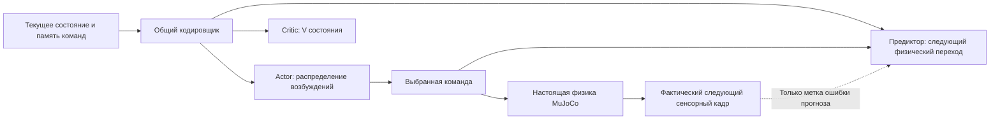

# Карта проведённых экспериментов

Исходный срез на **2026-11-07**, составленный во время документальной паузы;
ветка руки дополнена результатами **2026-11-09**.
Последующее возобновление опытов с общим кодировщиком отмечено в разделе 5.
Это краткий путеводитель;
параметры, команды, кривые и ограничения остаются в связанных отчётах.
Внутри каждого раздела опыты перечислены в порядке развития соответствующей
ветки. Параллельные ветки не образуют одну последовательность дообучения.

Навигация: [V0](#1-схематическая-рука-v0) ·
[контроллер MyoArm](#21-контроллер-и-критик) ·
[предиктор MyoArm](#22-предиктор-динамики) ·
[вертикальный предиктор](#31-предиктор) ·
[вертикальный контроллер](#32-контроллер-и-критик) ·
[выводы](#4-что-удалось-и-что-не-установлено) ·
[следующий шаг](#5-следующий-шаг-общий-кодировщик).

## Как читать результаты

- **Контроллер** выдаёт возбуждения; качество оценивается по замкнутому движению.
  **Предиктор** учится переходам состояния. **Критик** предсказывает ожидаемую
  дисконтированную сумму наград текущей стохастической policy.
- Различаем изменение **механики**, **заданий/данных**, **входов/памяти**,
  **награды или supervised loss**, **архитектуры** и **оптимизации/бюджета**.
  Где меняли несколько факторов, нельзя приписывать результат одному из них.
- «Пройдено N/M» означает критерий именно данного отчёта. Для позиционного PPO
  вертикального стенда это обычно ошибка ≤5 mm и скорость ≤0,03 m/s хотя бы
  90% последней секунды 4-секундного эпизода. У руки, ускорений и MuscleMimic
  другие критерии. RMSE последней секунды не равна RMSE всей траектории.
- Большинство сравнений — один seed, фиксированные данные/бюджет. Остановка
  по бюджету не означает плато; инженерное validation-плато не доказывает
  предел точности. Best и last часто существенно различаются.
- В опытах с предиктором split делается целыми эпизодами. Многошаговый прогноз
  условен на заданную последовательность команд; реальные будущие ощущения —
  только метки. Транспортная очередь обычно сдвигается точно, а не выучивается.
- Данные и веса локальны в игнорируемом `runs/`. Основная воспроизводимая
  документация — ссылки ниже и [журнал проверок](validation.md).

Быстрый поиск по сути изменения; обозначения относятся к строкам разделов ниже:

| Что варьировали | Где искать |
| --- | --- |
| Физика: упругость, транспорт, активация, контакт, масса | MyoArm M2/M3/M11, вертикальные варианты 1–4, C9 |
| Задания, эталоны и покрытие состояний | M1/M2/M4/M7/M10/M12/M13, C1/C3/C4/C5/C8 |
| Reward, supervised loss и критерий выбора | M4/M5/M12/M13, D3, P5/P8/P9, C2/C3/C4/C8 |
| Доступная информация, история и частота | M6/M7, D4/D5, P2/P3/P4/P5/P7; состав текущего PPO-входа — раздел 4 |
| Размер/глубина, активации нейронов, резервуар | M8, D2, P3/P6/P9, C5/C7 |
| Оптимизатор, learning rate, PPO-параметры, бюджет/плато | M5/M6, P6/P8/P9/P10, C2/C6/C7 |
| Проверка причин: GAE, critic, Jacobian и динамика движения | M9/M10, D1–D5, P1/P6/P7/P10, C8/C9/C10 |

## 1. Схематическая рука V0

Один сустав, четыре схематические мышцы, аналитический reference.
Это историческая физика и старые контракты, **не MyoArm и не вертикальный стенд**.

| Опыт / что меняли | Результат и границы | Подробности |
| --- | --- | --- |
| Контроллер: PPO tracking, увеличение бюджета с 4096 до 100096 переходов | На трёх проверочных эпизодах RMSE угла 6,97–8,38° против 2,79–3,30° у эвристики. Движение выучено частично; не приёмка D1. | [Историческая проверка V0](validation.md#историческая-проверка-v0) |
| Предиктор: история → ошибка угла/скорости через 100 ms, MLP 185→32→2 | Validation RMSE 0,008595 rad / 0,029475 rad/s, лучше двух простых baseline. Независимого test нет. | [Предиктор V0](validation.md#предиктор) |
| Связка predictor wrapper + PPO | Выполнен smoke на 128 переходов, загрузка и rollout. Работоспособность пути проверена; улучшение качества управления не измерено. | [Предиктор V0](validation.md#предиктор) |

## 2. Рука MyoArm: шесть мышц, один локоть

Моторная задержка, активация, независимое упругое сухожилие и capacity proxy.
В ходе разработки менялась и сама задача: от команды угла/триггера и release
к фиксированным коротким упражнениям. Физика до и после контакта несовместима.

Предварительная калибровка силы/утомления, снятие упора 130°, проверка
прикреплений/ориентаций и мягкие профильные оболочки — отдельные изменения
стенда, не достижения policy. См. [калибровку](calibration.md),
[геометрию](myoarm.md), [границы D1](first-stage.md).
Анатомическая точность и завершённая UE/Flesh/skin-интеграция не заявляются.

### 2.1. Контроллер и критик

| Опыт / категория | Что попробовали и что получилось | Подробности |
| --- | --- | --- |
| M1. Способ обучения | PPO с нуля и PPO после imitation не дали полезного управления; дообучение могло разрушать инициализацию. Imitation эвристики и исправления на состояниях actor дали рабочие отдельные движения. | [Первые сравнения D1](validation.md#обучение-проверка-поведения-включая-неудачные-опыты), [исправление демо](validation.md#исправление-нейросетевого-демо--2026-11-01) |
| M2. Данные и калибровка до контакта | Семь этапов imitation, 264 тыс. переходов: асимметрия capacity, достижимые состояния возле вертикали, release и переходы. Итоговый исторический actor удерживал 1 kg 300 s при целях 75/125°: 74,65/125,95°. Успех на этой прежней физике, не перенос на контактную модель. | [Итоговые проверки actor](validation.md#итоговые-проверки-сохранённого-actor) |
| M3. Адаптация к контактной механике | Повторные imitation/refinement/взвешивание данных. `contact_weighted` удерживал 300 s цели 75/125° и расслаблялся после release; отдельный подъём к 120° застревал на 104,87°, слабый триггер оставался неточным. | [Контроллер под контакт](validation.md#обучение-контроллера-под-профильный-контакт--2026-11-0102) |
| M4. Задания и награда за результат | Вместо длинных случайных сценариев: проход 15–150° вверх/вниз, 20→75°, 75→20°, три триггера и две capacity. PPO продолжен до плато: 0/12 движений и 0/6 проходов. | [Оценка](evaluation.md), [компактный PPO](validation.md#продолжение-компактного-ppo-до-результата-или-плато--2026-11-02) |
| M5. Масштаб, входы, шум, PPO-параметры | Масштаб reward/value 0,01 и центрирование устранили воспроизводимое насыщение critic в коротких проверках. Варьировали gSDE, длительность шума, rollout, lambda, амплитуду исследования. Улучшение общей оценки не дало успешных упражнений. | [Диагностика PPO](ppo-diagnosis.md) |
| M6. Распределение действий и память | Gaussian заменён ограниченной Beta; отдельно проверена авторегрессионная смесь с прежней командой. Связанное исследование расширяло охват, но упражнения не освоены. Искусственная persistent-семантика отвергнута; далее команды — прямые возбуждения. | [Ограниченный контроллер](bounded-controller.md) |
| M7. Подготовленные состояния | Перед передачей управления actor эвристика физически готовила удержание. Первый этап вышел на плато: best 3/18 коротких удержаний; следующие этапы не достигнуты. Persistent Beta в этом опыте — исторический вариант. | [Подготовленный curriculum](prepared-curriculum.md) |
| M8. Размер и глубина сети | Раздельные actor/critic 128×128 против 1024×1024×512, 773 входа истории/состояния, Tanh. Обе серии остановились на 117760 шагах без освоенных движений. Простое увеличение ёмкости проблему не решило. | [Архитектура](bounded-controller.md#сравнение-ширины-и-глубины-mlp--2026-11-02), [разбор весов](controller-learning-review.md) |
| M9. Аудит GAE, исследования и critic | Полезные случайные движения действительно находились; веса не просто перестали обновляться. Рекурсия GAE воспроизводилась, но локальное ранжирование critic могло быть неверным. Короткие обновления по GAE/MC не превратились в готовый навык. | [Аудиты обучения](controller-learning-review.md) |
| M10. Поэтапные задания | Лестница от подъёма 20→30° до полного compact. Реально выполнен только первый этап: 64768 переходов с продолжением, 0/6. Случайные разгоны до 145° при цели 30°, устойчивое попадание не найдено. | [Curriculum](movement-curriculum.md), [разбор траекторий](controller-learning-review.md) |
| M11. Упрощение механики | Одновременно убраны транспорт, постепенная активация и compliance сухожилия; тот же PPO/curriculum и бюджет. Ранний прогресс быстрее, итог 0/6 у упрощённой и полной модели. Задержки не оказались достаточным объяснением провала. | [Абляция приводов](controller-learning-review.md) |
| M12. Эталон команд против эталона ускорений | На упрощённой механике: регрессия возбуждений эвристики против ошибки ускорения через механический отклик. После добавления меток на собственных состояниях обе ветви прошли 6/6 на 4 s; на 20 s команды — 0/6, ускорения — 6/6. Это узкий подъём 20→30°, не полный диапазон. | [Supervised-сравнение](controller-learning-review.md) |
| M13. Отложенное ускорение на исходной механике | Градиенты будущего native-отклика с сохранением задержки/упругости и teacher-продолжением. Fresh capacity: 3/3, capacity 0,8: 0/3; локально полезный градиент есть. Полной задачи и обобщения не получено; PPO/GAE здесь не применялись. | [Отложенные ускорения](controller-learning-review.md) |
| M14. Возврат с вертикального стенда на MyoArm | Шесть мышц, 1 kg, исходные упругость/задержки. По 131072 PPO-перехода: без h1 test 7,334°;2/11, frozen h1 28,085°;1/11. На motor-test q20/q60 0,049/0,221°, на новых PPO-состояниях q20 0,31–0,33°; [обнаружен сдвиг распределения проб](arm-predictor-movement-coverage.md). Достигнут бюджет, не подтверждённое плато. | [Протокол и результаты](arm-preacher-training.md) |
| M15. Расширенные данные предиктора руки | 67400 train-переходов; та же сеть/нормировка, дообучение 78000 updates. На новых policy-test q20/v20 улучшились 0,289°/10,39°/s→0,075°/3,45°/s; старый motor-test не ухудшился. PPO131072: best3/9 validation, но 0/11 test и 29,643°; last1/11 и 21,430°. Все validation-успехи одной цели 75°; улучшения управления не получено. | [Расширенные данные и PPO](arm-balanced-predictor.md) |
| M16. Learning rate и масштаб frozen-h1 | Меньший LR1e−4/3e−5 почти устранил KL-stop, но test32,547°/56,944° не улучшил. При прежнем LR3e−4 gain0,25 дал10,400°;2/11 против29,643°;0/11 у gain1. Baseline без h1 остаётся точнее:7,334°;2/11; остаётся провал20→75° и плохое непрерывное демо. Предиктор/физика/награда неизменны, один seed. | [Таблицы и диагностика](arm-ppo-conditioning.md) |
| M17. Readout и глубина после concat | Компенсация h×0,25/weights×4 сохраняет prediction/команды/V точно. В initial меняющийся вклад h/private отличается≈9,1 раза, при gain0,25≈2,3. Добавление2→4 слоёв после concat при том же PPO не помогло: test33,856°;1/11 против10,400°;2/11, KL-stop106/128 против85/128. Один seed, общий бюджет131072, frozen predictor; это не доказательство предела глубокой сети. | [Разбор масштабов и опыт глубины](arm-predictor-readout-and-depth.md) |
| M18. Диагностика переноса и исполнения | Вертикальный reset предварительно балансирует груз, arm стартует с0,03 и падает до доставки команд. У frozen gain0,25 на20→75° mean RMSE53°, stochastic14–16°; оба неточны. Найдены два режима≈22°/84° и переключение200-ms импульсом сгибателей. Асимметрия активации15/50 ms преобразует шум в смещение средней активации. Парные полезные импульсы имеют положительные Δreturn/ΔGAE; систематического переворота знака не найдено. Нового обучения нет, trigger постоянно1. | [Измерения и гипотезы](arm-learning-bottlenecks.md) |
| M19. Гипотезы и раздельные проверки | Начальные V занижают независимый12-s MC, но подавление actor нормой critic не найдено. Замороженная policy зависит от шума; удлинение/расширение начального исследования не дало достижения. Лучшие старые ветви не вышли на установленное плато. Из none131072 выполнены три продолжения по32768: прежний PPO test8,618°;3/11, только меньший LR1e−4 —4,002°;4/11, только чередование целей —5,122°;3/11. LR уменьшил разовый exact KL и позволил1997 SGD вместо153; одна исходная policy/seed, остальные условия сохранены. | [План, измерения и ограничения](arm-hypotheses.md) |
| M20. Продолжение с меньшим LR | Без предиктора, LR1e−4, прежние сеть/физика/reward/порядок задач. Ещё49152 перехода и1410 SGD дали validation9/9 и test10/11; test tail RMSE4,002→1,940°. Все пять перемещений прошли, удержание15° осталось неточным5,668°. Остановка по успеху validation, не плато; один seed, знакомые задания. | [Протокол, кривая и демо](arm-low-lr-continuation.md) |
| M21. Возврат frozen и ещё меньший LR | Четыре продолжения по65536 из лучших отдельных родителей, LR1e−4/3e−5. Frozen gain0,25: test4,483°;5/11 →3,492°;5/11, validation6/9→7/9. None: best по validation при3e−5 ухудшил test1,940°;10/11→2,264°;8/11. Замена h1 константой у лучшего frozen сохраняет7/9; сильная причинная польза представления не установлена. Остановка по бюджету, не плато; последний frozen ещё улучшался. | [Таблицы, признаки и демо](arm-predictor-lower-lr.md) |
| M22. Разные грузы и начальная capacity | Без предиктора,4×128 SiLU/RMSprop. Массы0,5/1/2 kg;capacity0,7/1: общий mass-test26/33;1,782°,четыре20-s удержания приcapacity0,85 —4/4;0,860° вместо0/4;6,624° у родителя. Ориентация30°. | [Серия E2/E4](arm-load-orientation-efficiency.md) |
| M23. Полный круг ориентации и коррекция отклонений | При1 kg:validation22/24,test21/24;1,424°. С разными массами baseline остановилась на плато:56/72;2,240°,корректирующие старты после131072 —57/72;2,098°. На12 сложных учебных условиях6/12 против12/12 эвристики. Сбалансированный reset тоже не спасает125°/tilt135°/2 kg: learned17,912°,heuristic0,0155°. | [E5/E8/E10/E11 и диагностика](arm-load-orientation-efficiency.md) |
| M24. Стоимость активации/утомления | Парная добавкаa² не достигла efficiency-gate. Добавка0,3·mean(a·capacity) после общего validation-only отбора далаtest26/33 против25/33 контроля,active fraction−4,26%.20-s holds обе4/4;общая net-loss capacity−1,25%,максимальная−23,74%,но coactivation выросла. Один seed;10%-gate active fraction не пройден. | [Парные E6/E7](arm-load-orientation-efficiency.md) |

Итог ветки: отдельные imitation/supervised-навыки и полезные позиционные PPO-policy
получены; устойчивый PPO
для согласованной полной программы MyoArm не получен. Высокоуровневый/низкоуровневый
контроллер обсуждался и [записан как идея](controller-learning-review.md),
но два обученных уровня не реализованы.

### 2.2. Предиктор динамики

Задача: предсказывать физический переход по состоянию и командам, затем оценить
пригодность для управления. Данные — моторные пробы, не reward/метки actor.
Контроллер в этих опытах не обучался.

| Опыт / категория | Что меняли и результат | Подробности |
| --- | --- | --- |
| D1. One-step против BPTT | MLP 128×128 предсказывает приращения физического состояния за 20 ms; BPTT — шесть шагов. Обе лучше сохранения скорости, преимущество BPTT на 120 ms небольшое. Резкие нижние остановки/отскоки предсказываются плохо; Jacobian команд недостоверен. | [Динамика руки](dynamics-prediction.md) |
| D2. Ширина/глубина | Повтор на 1024×1024×512, те же данные и updates. Ошибки скорости уменьшились, достоверность градиента для actor не обеспечена. | [Большая сеть](dynamics-prediction.md#повтор-с-большой-сетью-10241024512--2026-11-05) |
| D3. Ускорение вместо скорости в loss | На одном шаге нормированные ошибки эквивалентны; изменена именно многошаговая ошибка — локальные приращения вместо накопленной скорости. Устойчивого выигрыша по ускорению/производным нет. | [Цель ускорения](dynamics-acceleration.md) |
| D4. Доступные ощущения | Добавлены причинные скорости волокон и силы сухожилий. На 120 ms RMSE скорости уменьшилась примерно на 6%, но общий Jacobian ухудшился. Расширение входа не решило задачу управления через модель. | [Сенсоры](dynamics-sensors.md) |
| D5. Шаг и память команд — остановлен | 20/5/1 ms, также история уже дошедших команд; физика всё время 1 ms. Обучения дошли до 2000 updates, последняя оценка не завершена, `stopped_by_user`. Найдена локальная чувствительность развёртки через конечную разность скорости волокна. Завершённого общего рейтинга нет. | [Частота предиктора](dynamics-timestep.md) |
| D6. Прямой прогноз60 ms и поздний ввод команды | Encoder33→4×128, head concat128+u6→128→20, без BPTT, те же621 эпизод с whole-episode splits.150000 updates; на общем test угол/скорость0,1559°/3,441°/s против0,1800°/3,999°/s у старой модели×3. Активации и прогноз актуальных policy хуже. В16 парах команд ошибка эффекта скорости9,07 против3,37°/s, эффекта угла0,114 против0,205°. Бюджет, не плато; PPO не запускался. | [Схема, все каналы и проверка команд](arm-anticipation60.md) |
| D7. Бюджет прямого60-ms предиктора | Продолжение150000→450000 с полным RMSprop/RNG, прежними данными/LR; best448000. Validation MSE0,02775→0,00960, test0,1559°/3,441°/s→0,1009°/2,229°/s. На актуальном none0,208°/5,597°/s→0,091°/3,081°/s. Отклик скорости улучшился9,07→6,35°/s, но старый×3 ещё точнее3,37°/s. Последнее улучшение почти в конце, остановка по бюджету; PPO не обучался. | [Продолжение и сопоставимые оценки](arm-anticipation60-continuation.md) |
| D8. PPO со старым/новым/без предиктора, общий старт | Один none-parent212992, одинаковые trainable weights/RMSprop moments, нулевые начальные readout-колонки, gain0,25. По65536 переходов, LR3e−5. Last test: none2,264°;8/11, old20 2,144°;8/11, new60 2,709°;7/11. Best old20 2,125°;9/11; у new60 best остаётся initial без вклада признаков. Новый прогноз не улучшил PPO; прежнее демо сохранено. | [Схема, общий старт, best/last и test](arm-anticipation-ppo.md) |

## 3. Вертикальный стенд: груз между двумя мышцами

Переход к минимальному примеру после трудностей с рукой. MuJoCo движет груз
по одной вертикальной оси; верхняя/нижняя мышцы тянут в противоположные стороны.
Физика 1 ms, типичное управление 20 ms, исходная масса 1 kg, без утомления
и контакта. Четыре механики:

| Вариант | Упругость мышц/отдельного сухожилия | Транспорт 40 ms | Постепенная активация 15/50 ms |
| --- | --- | --- | --- |
| 1 | Нет | Нет | Нет |
| 2 | Есть | Нет | Нет |
| 3 | Есть | Есть | Нет |
| 4 | Есть | Есть | Есть |

Все четыре проверялись в основных predictor/PPO-сериях. Поздние архитектурные
сравнения, новый log-reward, mass/critic audits ограничены механикой 4.
MuscleMimic-адаптация управляет с частотой 100 Hz — отдельный протокол.

### 3.1. Предиктор

Исходные данные: движения эвристики, по 6/3/3 train/validation/test эпизода
на механику. Обычные прогнозы и чувствительность к командам проверяются отдельно.

| Опыт / категория | Что меняли и результат | Подробности |
| --- | --- | --- |
| P1. Четыре механики, one-step/BPTT | MLP 128×128 Tanh, приращения всего физического состояния, BPTT 120 ms. Получен полезный прогноз обычных движений. В механике 4 историческая RMSE положения 0,0117 mm на 20 ms и 0,1105 mm на 120 ms; малые ошибки состояния не обеспечивают правильный отклик на команды. | [Первый предиктор](vertical-predictor.md) |
| P2. Явная история ощущений 200 ms | В полной механике test velocity RMSE на 20 ms уменьшилась 0,506→0,263 mm/s, на 120/400 ms ухудшилась. В других механиках общего выигрыша нет. | [История ощущений](vertical-sensory-history.md) |
| P3. Рекуррентный резервуар | Вместо явного окна — фиксированный резервуар 256 с MLP или линейным readout. Сравнение во всех четырёх механиках; универсального выигрыша нет, линейный readout особенно слаб на длинном горизонте. | [Резервуар](vertical-reservoir.md) |
| P4. Короткая история 60 ms | Три прошлых кадра вместо десяти. В механике 4 test MSE состояния ниже на 46% относительно отсутствия истории, velocity RMSE 120 ms — 0,876 mm/s. Не лучше на каждом горизонте; при BPTT история сдвигается собственными прогнозами. | [Сокращение истории](vertical-sensory-history.md#сокращение-истории-до-60-ms--2026-11-05) |
| P5. Локальные ощущения вместо координаты груза | Прогноз относительных длин волокон/сухожилий; отдельные ветви с производными на входе и с их ошибкой в loss. Ошибка ускорений местами уменьшилась ценой длин/скоростей; только добавление производных во вход могло ухудшить развёртку. | [Локальный предиктор](tissue-predictor.md) |
| P6. Ширина, глубина и validation-плато | 128×128, 512×512, 512×512×256, до 6000 BPTT updates. В механике 4 deep уменьшил нормированную ошибку местных скоростей примерно на 15%, Jacobian — на 22%, но ухудшил base MSE длин/активаций. Единой лучшей сети нет. | [Ёмкость и качество](tissue-quality-and-capacity.md) |
| P7. Более частые ощущения | История через 20/5/1 ms при командах каждые 20 ms; отдельно менялся нейронный шаг развёртки. Текущая скорость стала лучше наблюдаема, прогноз не улучшился универсально. В механике 4 на 60 ms 1-ms развёртка хуже; часть метрик Jacobian лучше. | [Частота истории](tissue-sampling.md) |
| P8. Аудит оптимизации/loss | На частом шаге первый Adam-update BPTT при lr=0,001 резко ухудшал loss; локальная проба меньшего lr устраняла скачок. STD-нормировка задаёт сильные неявные веса каналов. Это аудит копий, не полноценное новое обучение с меньшим lr. | [Параметры обучения](tissue-training-review.md) |
| P9. Возврат к исходному стенду: lr, затем активации | Без локальной/частой истории. Последовательно сравнили lr, Tanh/SiLU/LeakyReLU, линейный/обычный/масштабированный Tanh-выход. Общий validation-выбор не дал универсального test-выигрыша. Обычный Tanh ±1 STD ограничивал представимые приращения. | [Подбор параметров](vertical-tuning.md) |
| P10. Бюджет ×10 и уменьшенный lr | 10000 one-step + 20000 BPTT updates, четыре lr. Выбрана общая пара 0,001/0,0003; основная польза пришла от бюджета. Механика 4: position RMSE 0,0083/0,0306/0,0635 mm на 20/60/120 ms. Относительная ошибка Jacobian скорости на 60 ms всё ещё 52,5% в шести пробах. | [Длинное обучение](vertical-budget.md) |
| P11. Отдельное обучение текущего h1 на моторных пробах | Та же 4×128 SiLU/8 входов/RMSprop, фиксированные 32/12/12 эпизодов independent/reciprocal/common/multisine, 50000 updates. Новый test q20/v20: 0,041 mm/2,53 mm/s против 1,00 mm/101,16 mm/s у parallel actor-best. Прогноз заметно лучше, но Jacobian 60 ms на 12 общих пробах хуже: 61,0% против 30,1%. Новый PPO не проводился. | [Моторное исследование](body-predictor-pretraining.md) |

Результаты P10 относятся к исходной компактной схеме без истории ощущений
и резервуара, не являются финальной моделью, вобравшей все изменения P2–P8.
Результаты получены на фиксированном распределении эвристики; их перенос
на текущую PPO-policy, другую массу или произвольные команды не установлен.

### 3.2. Контроллер и критик

| Опыт / категория | Что меняли и результат | Подробности |
| --- | --- | --- |
| C1. PPO за положение/скорость | Отдельные actor/critic 128×128 Tanh, прямые Beta-команды. Test pass вариантов 1/2/3/4: **5/5, 5/5, 2/5, 3/5**; steady RMSE 0,359/2,887/6,256/4,213 mm. Задержанные механики чаще дают постоянное смещение. | [Позиционный PPO](vertical-ppo.md) |
| C2. Изолированный подбор десяти параметров | На вариантах 2/3/4 по одному меняли lr, rollout, entropy, lambda, gamma, batch, epochs, clip, target KL и ширину position reward. 48 ветвей продолжения с общим родителем, не обучения с нуля. Есть локальные улучшения; полного освоения задержанных механик нет. | [Таблицы sweep](vertical-ppo-sweep.md) |
| C3. Награда за ускорение из PD | Заменено только позиционное слагаемое на совпадение фактического среднего ускорения с PD-эталоном в начале интервала. Варианты 1–4: test по положению по 1/5, хуже C1. Уменьшение acceleration RMSE не дало точного позиционирования. | [Acceleration PPO](vertical-acceleration-ppo.md) |
| C4. Низкоуровневая цель «ускорение через 40 ms» | Задание с очередью и preview 0/20/40 ms, новые профили ускорений; целей положения нет. **0/16** ненулевых test-профилей освоено. Нулевой профиль прошёл только вариант 4. Это другая задача, не изолированная поправка тайминга C3. | [Scheduled PPO](vertical-scheduled-ppo.md) |
| C5. Методология MuscleMimic, CPU-адаптация | Reference imitation, preview, нормировки, Gaussian, SiLU/LayerNorm, исходные PPO/GAE/Muon. Реально **4×256**, а не source-config 4×1024; 128 updates, 327680 transitions на механику. Все клипы завершаются, strict test 2/5, 2/5, 1/5, 0/5. Полной репликации исходной статьи нет, плато не установлено. | [MuscleMimic](vertical-musclemimic.md) |
| C6. Adam против Muon в C5 | Только механика 4, одинаковые 128 итераций. Muon test RMSE 20,62 mm, Adam best 29,78 mm; оба strict 0/5. Adam после best ухудшается. CPU-замер полного PPO-update быстрее примерно в 11,7 раза у Adam; это отдельный benchmark. | [Оптимизаторы MuscleMimic](vertical-mimic-optimizers.md) |
| C7. Архитектура/оптимизатор собственного PPO | Механика 4, семь обучений с нуля по 131072 перехода: контроль, SiLU, 4×128, RAdam, RMSprop, Muon и комбинация 4×128 SiLU RMSprop. Muon best: steady test 2,44 mm, 4/5; deep 2,92 mm, 4/5; комбинация 2,52 mm, 4/5. Ни одна не прошла 5/5. Глубина и Muon помогли части метрик; комбинация не стала общей лучшей. | [Архитектурный опыт](vertical-architecture-ppo.md) |
| C8. Плотность заданий + нелинейная награда | Только 4×128 SiLU RMSprop: 9→33 train-сценария, логарифмическая позиционная награда с ε=5 mm. Старый test 4/5→5/5, RMSE 2,52→3,08 mm; расширенный test 9/11 у обеих, RMSE 2,87→3,57 mm. Перелёты вниз 6,02/9,59 mm исчезли, подъёмы медленнее; смещение равновесия осталось. | [Dense/log PPO и движение](vertical-precision-ppo.md) |
| C9. Масса — только оценка переноса | Замороженный C8 best, 0,5/1/1,5/2/3/5 kg. На 1 kg — 9/11; на остальных — 0/11, без физического выхода из workspace. При 1 kg пик верхней activation 33,4%, excitation 39,2%. Насыщение не объясняет ошибку; обучение на нескольких массах ещё не выполнено. | [Масса](vertical-mass-ppo.md) |
| C10. Независимое качество critic | Тот же C8 best, 12 состояний × 6 stochastic-продолжений по 16 s, без critic-bootstrap. Mean bias −0,409, RMSE 0,455 при returns 8,07–8,83; EV≈0,19 и пример неверного ранжирования. Погрешность средних MC меньше найденных расхождений; главная причинная роль critic не доказана. | [Аудит критика](vertical-critic-audit.md) |
| C11. Общий encoder и auxiliary prediction | Три новых обучения по 131072 перехода с единым exact-KL guard: раздельные / shared / shared+predictor. Test RMSE 8,26 / 6,81 / 10,09 mm; pass 5/11 / 5/11 / 3/11. Предиктор обучился, общего улучшения управления/critic нет; строгий guard часто отменял updates. | [Первое сравнение](shared-encoder-ppo.md) |
| C12. Признаки предиктора с раздельными градиентами | Собственный predictor обучает h1; actor/critic получают stop_gradient(h1) и собственные h2/h3. Frozen/online по 131072 перехода: best test 3/11 и 8,32 mm / 8/11 и 4,53 mm. Online выполняет все четыре движения, last хуже (5/11); critic MC RMSE хуже 0,315→0,465. Отдельное предобучение — P11, перенос — C13. | [Раздельное обучение](detached-predictor-ppo.md) |
| C13. PPO с предобученным h1 | Три matched ветви по131072 PPO-перехода: random frozen / pretrained frozen / pretrained online. Best test **3/11;8,32 mm / 10/11;3,19 mm /1/11;19,87 mm**. Фиксированный предобученный h1 помог на этом seed; online специализировался на узких траекториях и забыл широкие моторные пробы. Все4 движения frozen проходят, провал — hold+70 mm. Last хуже best; PPO ещё нестабилен, масштаб h1 отдельно не контролировался. | [Перенос признаков](pretrained-predictor-ppo.md) |

В C1–C10 сравниваются разные критерии и наборы: RMSE всего reference-клипа
MuscleMimic нельзя ранжировать напрямую вместе с RMSE последней секунды
позиционного эпизода. В C8 одновременно менялись reward, train и validation;
отдельные вклады не изолированы. Удаление перелёта не равно точному попаданию:
на подъёме к +60 mm новая модель останавливается примерно на +55,34 mm.

## 4. Что удалось и что не установлено

| Относительный успех | Что остаётся открытым |
| --- | --- |
| Imitation и обучение по механическому ускорению дали отдельные полезные навыки руки. | Это не успешное PPO на всей MyoArm-программе; контакт/утомление/смена условий требуют собственных проверок. |
| PPO действительно освоил позиционирование простого вертикального стенда, особенно вариантов 1/2. | Статические ошибки, перенос на другую нагрузку, стабильность поздних updates и выполнение ускорительных заданий. |
| Ближний прогноз положения стал очень точным на траекториях эвристики. | Точность воздействия новой команды и качество градиента; «хороший прогноз» не означает «готовая модель для actor». |
| История, размер, функции активации, lr и бюджет влияют на результат. | Ни одна настройка не стала универсальным решением; больше updates не создаёт новых физических примеров. |
| Есть реальные аудиты GAE, critic, native replay, переноса checkpoint и торможения. | Корреляция плохого critic с плохим actor не доказывает единственную причину неуспеха. |

**Не смешивать входы разных опытов.** В C8 у actor/critic по 13 входов:
q/v, две длины волокон, две активации, четыре pending-команды, два предыдущих
возбуждения и цель. Нет отдельных сил/strain-сенсоров и сенсорной истории.
Расширенные локальные ощущения из predictor-веток туда не переносились.
Actor и critic в C8 имеют **раздельные** 4×128 SiLU сети. Более поздний
эксперимент с общим кодировщиком описан в C11, detached-признаки — в C12;
они не меняют прежние defaults.

## 5. Следующий шаг: общий кодировщик

**Обновление 2026-11-07:** после документальной паузы владелец разрешил
[первый эксперимент с общим кодировщиком](shared-encoder-ppo.md). Реализация
добавлена, сравнение трёх ветвей завершено: общий encoder без предиктора дал
5/11 test, с предиктором — 3/11; подробности и ограничения — в отдельном отчёте. Ниже сохранена исходная постановка идеи: три задачи над общим
представлением состояния вертикального стенда:

Продолжение C12: [раздельное обучение признаков предиктора и PPO](detached-predictor-ppo.md).
PPO использует detached-представление и собственные ветви, не обучает predictor
своими ошибками. Там же записана следующая гипотеза: предварительные моторные
пробы плавными случайными командами до PPO. Их отдельное обучение предиктора
теперь выполнено в [P11](body-predictor-pretraining.md); перенос в PPO проверен
в [C13](pretrained-predictor-ppo.md).

Кандидат архитектуры: **два общих слоя по 128 SiLU**, затем по два собственных
слоя actor/critic, отдельная голова предиктора. Команда добавляется в predictor
после её выбора actor; critic оценивает V(s), не Q(s,a). Канал цели и точный
состав общего входа нужно закрепить в протоколе до запуска. Нейронного
прогноза транспортной очереди не требуется: её причинный сдвиг остаётся явным.

Actor получает PPO-loss, critic — регрессию TD/GAE-return, predictor —
нормированную ошибку реально наблюдавшегося перехода. Общие веса получают
сумму этих градиентов с явно заданными коэффициентами. Будущие ощущения
не подаются в actor; PPO в первом опыте получает **настоящие физические
траектории**, не воображаемые rollouts и не градиент через модель динамики.
Это проверка пользы представления, а не готовый иерархический контроллер.

Перед запуском нужно зафиксировать:

1. **Контроль:** независимый текущий baseline; общий кодировщик без prediction-loss;
   тот же общий кодировщик с prediction-loss. В последних двух одинаковые
   архитектура/инициализация, данные заданий, reward и бюджет. Различие числа
   параметров с независимым baseline учитывать отдельно.
2. **Loss/обновления:** train-only масштабы сенсорных ошибок, вес prediction-loss,
   частоту updates и защиту PPO от чрезмерного сдвига общей representation.
   Обычный PPO clipping сам по себе не ограничивает изменения от auxiliary-loss;
   нужно контролировать KL policy с учётом всех updates.
3. **Проверку:** одинаковые tracking-критерии, full/steady RMSE, перелёты,
   торможение и установление; critic — независимые MC-продолжения стохастической
   policy; predictor — прогноз на 20/60 ms и ошибка воздействия команды.
   Известные test-сценарии не представлять новым независимым benchmark.
4. **Разнообразие:** обучение на нескольких массах и проверка промежуточных
   неучебных масс — отдельная гипотеза. Не приписывать его эффект общему
   кодировщику, меняя одновременно все условия без контроля.

Ожидаемый эффект — полезные физические признаки и возможность более частого
обучения представления по каждому переходу. Это не обещание улучшения critic
или устранения временного credit assignment; градиенты трёх задач могут
конфликтовать. В первоначальной постановке детали оставались открытыми;
параметры и фиксированный бюджет первого запуска теперь заданы в
[протоколе сравнения](shared-encoder-ppo.md).

Апикальные сигналы и замена backprop остаются темой отдельного проекта `bnn`;
в myo сейчас сохраняются обычный backprop и PPO. Двухуровневое управление,
мышечные синергии, обучение на модельных траекториях и прямое управление
через дифференцируемый предиктор остаются другими гипотезами, не результатами
или обязательными частями этого ближайшего опыта.
